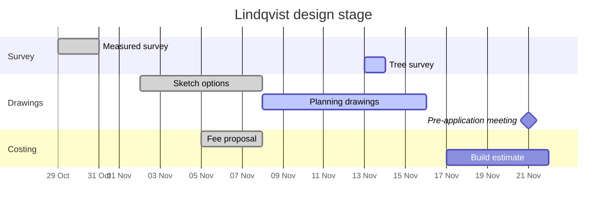

# Lindqvist cabin

Henrik and Sara Lindqvist, a cabin on their land above Corran Water. Weekends and some summer weeks, two of them and sometimes a grandchild. They want it to feel like it was always there.

## Brief, in their words

- "One good room, a place to sleep, and a door we can leave open"
- Wood burner, not a heat pump. They'll be there in winter.
- Sleeping loft over the bathroom, reached by a steep stair, not a ladder
- Deck facing the water, sheltered from the westerly
- Rainwater off the roof into a butt for the garden

## What we have so far

Floor plan sketch is on the whiteboard: [[Lindqvist floor plan]]. Kickoff notes: [[2026-11-05 Lindqvist kickoff]].

Rough sizes: 7.2 m x 4.2 m, pitched roof at 35 degrees, ridge under 4 m so it stays within what the planning officer said on the phone.

## Design stage

> [!warning] Access
> The track floods after heavy rain. Deliveries need a dry week and a small lorry, so plan for a crane-free frame we can carry in.

## Questions for the next meeting

1. Is the old stone wall staying? It decides where the deck goes.
2. Do they want the loft window to open? Fire escape says yes.
3. Budget ceiling, said out loud this time.
