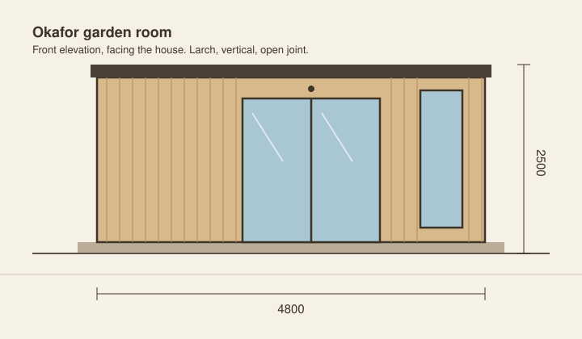

# Okafor garden room

Garden office for Ada Okafor at the end of her garden on Marsh Road. She translates from home and wants a room she can shut the door on at six. Contract signed 2026-10-02, on site since 2026-10-24.

> [!note] Where we are
> Frame and roof are on and watertight. Waiting on the glazed units, then cladding, then Dev for the first fix. Handover is booked for 2026-12-12 and that date is **tight**.

## The room

- 4.8 m x 3.6 m outside, 2.5 m to the top of the parapet
- Ground screws, 9 of them, on the old patio line
- Warm flat roof, EPDM, 25 mm fall to the back
- Larch cladding, vertical, open joint. Ada is still deciding between natural and charred, see the samples task
- Glazed double doors facing the house, one tall side window facing west

## Money

| Stage | What it covers | Share | Amount | Status |
| --- | --- | ---: | ---: | --- |
| 1 | Deposit and groundworks | 25% | £6,250 | Paid 2026-10-13 |
| 2 | Frame and roof complete | 35% | £8,750 | Invoice due |
| 3 | Glazing, cladding, first fix | 25% | £6,250 | |
| 4 | Handover and snag sign-off | 15% | £3,750 | |
| | | | **£25,000** | |

Margin on this one is thinner than it should be. The parapet detail took Tomas two extra days and we didn't charge for it. Note for [[Pricing a garden room]].

## Glazing sizes, as measured

| Unit | Drawn (mm) | Measured (mm) | Order |
| --- | --- | --- | --- |
| Double doors | 1798 x 2100 | 1790 x 2098 | 1780 x 2090 |
| Side window | 600 x 1800 | 602 x 1797 | 590 x 1785 |

Order size is the measured opening less 10 mm each way for packers. Toughened glass in the doors.

## Open decisions

- [x] Electric heating or the small wood burner: **electric panel**, Ada doesn't want to carry logs
- [x] Desk wall: left side, so she faces the garden
- [ ] Cladding finish: natural larch or charred
- [ ] Outside light over the door, warm white, on a sensor or a switch?
- [ ] Gutter at the back, or let it drip onto the gravel strip

## People

- Ada Okafor, client. Best on email in the morning, she works afternoons.
- Pete Lowe did the screws and the gravel strip.
- Dev Mistry for electrics. Armoured cable from the house is already in the trench.

Visit notes: [[2026-11-10 Okafor site visit]]. How we build these: [[Build sequence]]. Boards for the cladding: [[Cladding calculator]].
