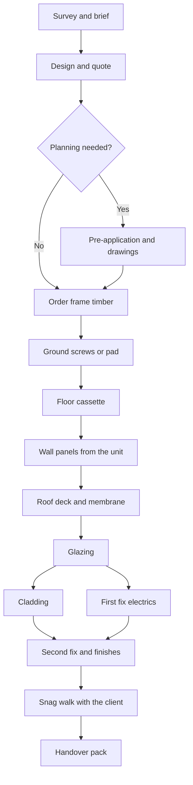

# Build sequence

How a garden room goes together, in order. Each box is a point where someone checks before the next trade starts.

## Notes

- Never clad before the glazing is in. We learned that on the first job.
- First fix can run alongside cladding, but agree with Dev which side he needs first.
- The snag walk is with the client, not for them. They find things we don't.

Handover: [[Handover checklist]].
