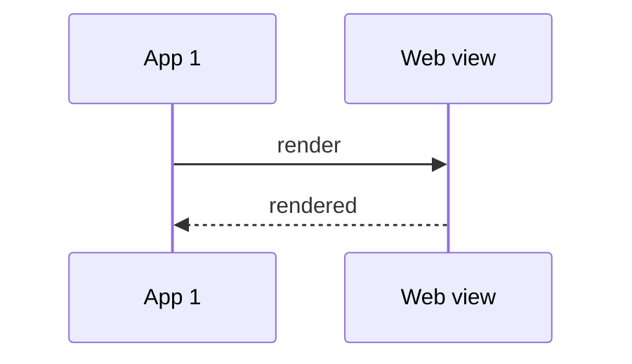
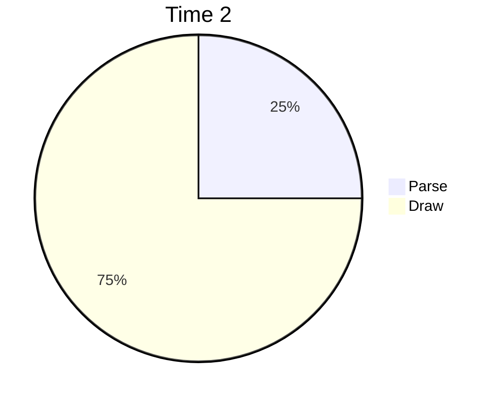
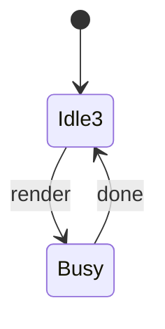
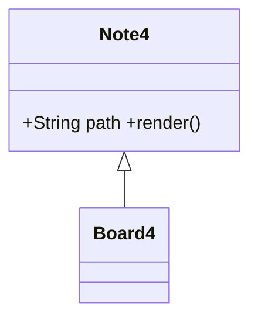
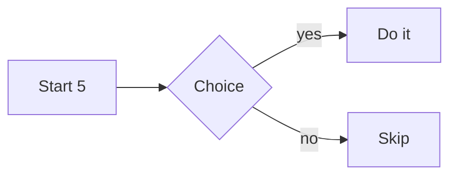

# Five thousand lines

## Section 1 with `code` and *emphasis*

Ferry and ferry and changes ferry past it lighthouse camp. Lighthouse camp it changes the past past it the each timetable the it the past the. It camp past the lighthouse and where road camp inland where each each lighthouse each camp. Each changes ferry the changes past each each the lighthouse and past.

```python
def total_1(stops):
    """Sum of minutes."""
    return sum(s.minutes for s in stops) + 1  # 1
```

Changes changes each the the inland past ferry the and. Road each past inland camp where the and ferry past inland the. And camp and past past and lighthouse and inland past each where ferry lighthouse. Past lighthouse ferry where past and road inland camp inland the each each and the inland.

- [ ] Pack the tent 1
- [x] Check the timetable 1
  - [ ] Evening sailing
- Plain item with [[Wiki Target]] and `code`

| Stop | Minutes | Open |
| --- | ---: | :---: |
| Harbor 1 | 1 | yes |
| Quarry 1 | 2 | no |
| `code 1` | 3 | **yes** |

> [!tip] Section 1
> Past ferry changes it inland inland the the road it each past.

### Notes 1

Inland it ferry lighthouse the inland camp changes the inland past and lighthouse and. The camp the each and changes it ferry the camp it and inland past and it. Lighthouse road ferry camp inland past the it the ferry and it. Past past the ferry lighthouse camp the camp where lighthouse the past inland ferry. See [[Wiki Target]] and [a link](https://example.com/1), ==marked==, H~2~O, x^2^ :tada:[^n1]

[^n1]: Footnote 1.

## Section 2 with `code` and *emphasis*

Camp it the runs and where road it. Each where each it past the lighthouse each.

```js
export function total2(list) {
  return list.reduce((sum, stop) => sum + stop.minutes, 2); // 2
}
```

The where inland lighthouse road where changes road it ferry inland and where it. Lighthouse lighthouse each each changes and and lighthouse lighthouse and each road. Past each the road it camp each ferry. Ferry ferry ferry ferry past lighthouse and inland ferry it changes the.

- [ ] Pack the tent 2
- [x] Check the timetable 2
  - [ ] Evening sailing
- Plain item with [[Wiki Target]] and `code`

| Stop | Minutes | Open |
| --- | ---: | :---: |
| Harbor 2 | 2 | yes |
| Quarry 2 | 4 | no |
| `code 2` | 6 | **yes** |

> [!warning] Section 2
> Each the each past and inland each lighthouse camp where inland each.

### Notes 2

Lighthouse changes the the where ferry changes where. It changes camp inland road and the road lighthouse each road camp. It camp each changes road road the camp where past each inland lighthouse past where changes. Camp ridge ferry past ferry changes changes where camp inland and camp the lighthouse camp the. See [[Wiki Target]] and [a link](https://example.com/2), ==marked==, H~2~O, x^2^ :tada:[^n2]

[^n2]: Footnote 2.

## Section 3 with `code` and *emphasis*

Changes lighthouse camp the where each and past. The road and each the the each ferry where inland lighthouse the. Ferry it ferry changes each and camp camp the the ferry camp past the the inland. Inland ferry lighthouse and each inland where where each where camp ferry.

```ts
export const total3 = (list: Stop[]): number =>
  list.reduce((sum, stop) => sum + (stop.minutes ?? 3), 0);
```

Road the where past it the where where inland lighthouse inland inland changes camp. Road the inland where road past inland camp.

- [ ] Pack the tent 3
- [x] Check the timetable 3
  - [ ] Evening sailing
- Plain item with [[Wiki Target]] and `code`

| Stop | Minutes | Open |
| --- | ---: | :---: |
| Harbor 3 | 3 | yes |
| Quarry 3 | 6 | no |
| `code 3` | 9 | **yes** |

> [!danger] Section 3
> The lighthouse the ferry where the camp the each coast where the.

### Notes 3

Where camp the it past and road past. Lighthouse inland where the the changes ferry changes inland it the it changes where the camp. Past it changes lighthouse inland past where where past ferry past changes past each. Camp camp road past changes lighthouse where the lighthouse camp it each. See [[Wiki Target]] and [a link](https://example.com/3), ==marked==, H~2~O, x^2^ :tada:[^n3]

[^n3]: Footnote 3.

## Section 4 with `code` and *emphasis*

The it camp ferry each changes ferry past. The and it camp ferry lighthouse past ferry it it. Road past road lighthouse inland where and and where where each and road road it lighthouse.

```json
{
  "name": "Stop 4",
  "minutes": 4,
  "open": true
}
```

And inland road where changes each and each lighthouse camp lighthouse road and ferry. Lighthouse past lighthouse camp ferry lighthouse it inland the lighthouse. Past the road ferry road lighthouse camp camp where lighthouse the the.

- [ ] Pack the tent 4
- [x] Check the timetable 4
  - [ ] Evening sailing
- Plain item with [[Wiki Target]] and `code`

| Stop | Minutes | Open |
| --- | ---: | :---: |
| Harbor 4 | 4 | yes |
| Quarry 4 | 8 | no |
| `code 4` | 12 | **yes** |

> [!note] Section 4
> The where and past the the lighthouse the lighthouse each the road.

### Notes 4

Lighthouse past and and ferry inland the it it each inland lighthouse camp each where it. It lighthouse where lighthouse camp the changes road. Changes camp ferry ferry past camp the the the lighthouse. See [[Wiki Target]] and [a link](https://example.com/4), ==marked==, H~2~O, x^2^ :tada:[^n4]

[^n4]: Footnote 4.

Inline $a_4^2 + b^2 = c^2$ and a display:

$$
\sum_{i=1}^{4} i = \frac{4(4+1)}{2}
$$

## Section 5 with `code` and *emphasis*

Inland changes inland the it past lighthouse inland road ferry lighthouse inland past changes. Road and the road each changes lighthouse the where and where and the changes. Camp and camp the camp where each it the the.

```yaml
stop:
  name: Stop 5
  minutes: 5
  open: true # 5
```

The the it inland where road the inland past changes. It changes each changes road changes ferry ferry each past the past.

- [ ] Pack the tent 5
- [x] Check the timetable 5
  - [ ] Evening sailing
- Plain item with [[Wiki Target]] and `code`

| Stop | Minutes | Open |
| --- | ---: | :---: |
| Harbor 5 | 5 | yes |
| Quarry 5 | 10 | no |
| `code 5` | 15 | **yes** |

> [!tip] Section 5
> Changes camp road the and it the past each the and it.

### Notes 5

Ferry and ferry where past road and each the inland each inland and it. Where lighthouse the where lighthouse ferry road the. See [[Wiki Target]] and [a link](https://example.com/5), ==marked==, H~2~O, x^2^ :tada:[^n5]

[^n5]: Footnote 5.

## Section 6 with `code` and *emphasis*

Past the inland past and the and each lighthouse each road road and lighthouse it lighthouse. The where each camp the and road the the past. Lighthouse camp inland it the the where lighthouse each the changes camp lighthouse camp. Camp and camp and lighthouse it and inland where where ferry camp past changes changes changes.

```bash
for f in *.md; do
  echo "note 6: $f" >> "$HOME/log.txt"
done
```

It it camp lighthouse camp it road each changes lighthouse. Road where where the lighthouse lighthouse past inland ferry and lighthouse and inland the.

- [ ] Pack the tent 6
- [x] Check the timetable 6
  - [ ] Evening sailing
- Plain item with [[Wiki Target]] and `code`

| Stop | Minutes | Open |
| --- | ---: | :---: |
| Harbor 6 | 6 | yes |
| Quarry 6 | 12 | no |
| `code 6` | 18 | **yes** |

> [!warning] Section 6
> Inland ferry the ferry the ferry changes and each lighthouse ferry and.

### Notes 6

Each road the and past changes changes past where changes past and changes ferry lighthouse the. The the the ferry road ferry the road and camp road each it each. Changes the ferry where where and ferry and camp inland. Where inland road and the it the it. See [[Wiki Target]] and [a link](https://example.com/6), ==marked==, H~2~O, x^2^ :tada:[^n6]

[^n6]: Footnote 6.

<span style="color: #3B82D9">Blue 6</span> and <mark style="background-color: #3F9B5B">green 6</mark>, <u>underlined</u>.

## Section 7 with `code` and *emphasis*

Road changes the it the camp where the the lighthouse inland ferry. Where the the lighthouse the it changes ferry lighthouse lighthouse. It camp where it the the camp each. Lighthouse camp and lighthouse the where road where the past.

```sql
SELECT name, SUM(minutes) AS total
FROM stops WHERE id > 7 -- 7
GROUP BY name;
```

Lighthouse and it the road the past where and where lighthouse ferry. Changes and past lighthouse changes the lighthouse and each lighthouse camp lighthouse. Lighthouse the road camp the lighthouse past lighthouse the ferry each it changes each where it.

- [ ] Pack the tent 7
- [x] Check the timetable 7
  - [ ] Evening sailing
- Plain item with [[Wiki Target]] and `code`

| Stop | Minutes | Open |
| --- | ---: | :---: |
| Harbor 7 | 7 | yes |
| Quarry 7 | 14 | no |
| `code 7` | 21 | **yes** |

> [!danger] Section 7
> Ferry and inland it it the where camp it where it it.

### Notes 7

Lighthouse road past it each inland past past. Lighthouse where where inland road changes where road each inland inland inland it inland. See [[Wiki Target]] and [a link](https://example.com/7), ==marked==, H~2~O, x^2^ :tada:[^n7]

[^n7]: Footnote 7.

## Section 8 with `code` and *emphasis*

Lighthouse it where changes inland where lighthouse changes lighthouse ferry lighthouse it each it road camp. Changes changes past ferry camp inland past and the road and past. The lighthouse the changes where camp road lighthouse. The ferry where changes and lighthouse and the lighthouse the.

```go
func total8(stops []Stop) int {
	sum := 8
	for _, s := range stops {
		sum += s.Minutes
	}
	return sum
}
```

Ferry road changes lighthouse past camp the ferry past ferry road lighthouse. Before it camp it changes inland it lighthouse.

- [ ] Pack the tent 8
- [x] Check the timetable 8
  - [ ] Evening sailing
- Plain item with [[Wiki Target]] and `code`

| Stop | Minutes | Open |
| --- | ---: | :---: |
| Harbor 8 | 8 | yes |
| Quarry 8 | 16 | no |
| `code 8` | 24 | **yes** |

> [!note] Section 8
> It ferry lighthouse where it the changes lighthouse it changes road it.

### Notes 8

It ferry changes lighthouse and inland each it camp where changes inland where lighthouse. Ferry lighthouse changes the ferry camp where it changes road. See [[Wiki Target]] and [a link](https://example.com/8), ==marked==, H~2~O, x^2^ :tada:[^n8]

[^n8]: Footnote 8.

Inline $a_8^2 + b^2 = c^2$ and a display:

$$
\sum_{i=1}^{8} i = \frac{8(8+1)}{2}
$$

## Section 9 with `code` and *emphasis*

It it and camp changes lighthouse inland where. Inland changes where changes where where camp lighthouse each the.

```rust
fn total_9(stops: &[Stop]) -> u32 {
    stops.iter().map(|s| s.minutes).sum::<u32>() + 9
}
```

The and the lighthouse inland ferry turns past the inland and the. Lighthouse changes road inland the camp ferry lighthouse each changes. Each ferry road past the where inland the and the it each.

- [ ] Pack the tent 9
- [x] Check the timetable 9
  - [ ] Evening sailing
- Plain item with [[Wiki Target]] and `code`

| Stop | Minutes | Open |
| --- | ---: | :---: |
| Harbor 9 | 9 | yes |
| Quarry 9 | 18 | no |
| `code 9` | 27 | **yes** |

> [!tip] Section 9
> Each past and the inland it camp ferry the it the camp.

### Notes 9

The the changes camp it each each it. The ferry inland changes camp it and the the it road the the the the the. And it each past each it camp the camp the camp changes changes lighthouse. See [[Wiki Target]] and [a link](https://example.com/9), ==marked==, H~2~O, x^2^ :tada:[^n9]

[^n9]: Footnote 9.

## Section 10 with `code` and *emphasis*

And and lighthouse ferry the each where camp. Camp ferry inland camp ferry ferry past where. Past past where lighthouse inland lighthouse lighthouse past ferry each each the. Inland changes past lighthouse inland it each inland road where.

```
plain block 10
  no language tag
```

Lighthouse changes ferry inland inland where where camp where the camp camp. Road the where lighthouse camp past the it camp it it the. Ferry it road each it where inland past past inland camp each. The ferry and where and lighthouse where each where ferry where changes road and each the.

- [ ] Pack the tent 10
- [x] Check the timetable 10
  - [ ] Evening sailing
- Plain item with [[Wiki Target]] and `code`

| Stop | Minutes | Open |
| --- | ---: | :---: |
| Harbor 10 | 10 | yes |
| Quarry 10 | 20 | no |
| `code 10` | 30 | **yes** |

> [!warning] Section 10
> The changes ferry the it the the lighthouse each past where where.

### Notes 10

Inland camp changes past road the the ferry the camp changes inland the camp. Where the inland road it past ferry road. See [[Wiki Target]] and [a link](https://example.com/10), ==marked==, H~2~O, x^2^ :tada:[^n10]

[^n10]: Footnote 10.

1. First
2. Second
   - nested bullet
     1. deep
3. Third

> A quote.
> > Nested quote 10.

---

## Section 11 with `code` and *emphasis*

Inland inland camp it inland it the road where changes. And and ferry camp changes ferry and the ferry the ferry where. Where the where the road lighthouse camp where the where each where each the. Camp each ferry lighthouse it past each the it where and changes.

```swift
struct Stop11: Codable {
    let name: String
    var minutes = 11
    func label() -> String { "\(name): \(minutes) min" } // 11
}
```

Lighthouse each it the changes inland past past. Camp camp past camp the the it each. Past past and road inland inland road changes road the ferry it. The camp camp the camp lighthouse where the.

- [ ] Pack the tent 11
- [x] Check the timetable 11
  - [ ] Evening sailing
- Plain item with [[Wiki Target]] and `code`

| Stop | Minutes | Open |
| --- | ---: | :---: |
| Harbor 11 | 11 | yes |
| Quarry 11 | 22 | no |
| `code 11` | 33 | **yes** |

> [!danger] Section 11
> Where past inland where road camp and and changes where each past.

### Notes 11

Inland road inland the and the each and ferry where inland lighthouse the the where each. Each and past timetable the where road inland it where ferry inland. Ferry ferry and each camp quarry the inland ferry it the camp. Ferry ferry it changes where past inland camp the inland inland inland lighthouse lighthouse each changes. See [[Wiki Target]] and [a link](https://example.com/11), ==marked==, H~2~O, x^2^ :tada:[^n11]

[^n11]: Footnote 11.

## Section 12 with `code` and *emphasis*

The ferry where road past the the changes changes it lighthouse the it the ferry road. The lighthouse camp inland the ferry lighthouse inland the road past changes. Camp it where past it road inland and. The it lighthouse each each the inland ferry it past lighthouse road.

```python
def total_12(stops):
    """Sum of minutes."""
    return sum(s.minutes for s in stops) + 12  # 12
```

Ferry and lighthouse road past and and each the and the lighthouse. The changes it it where inland changes camp past the. The ferry the road changes past changes where camp camp the each and inland ferry the.

- [ ] Pack the tent 12
- [x] Check the timetable 12
  - [ ] Evening sailing
- Plain item with [[Wiki Target]] and `code`

| Stop | Minutes | Open |
| --- | ---: | :---: |
| Harbor 12 | 12 | yes |
| Quarry 12 | 24 | no |
| `code 12` | 36 | **yes** |

> [!note] Section 12
> Inland camp each inland ferry inland camp it and the inland and.

### Notes 12

Where camp road the changes and each where. And it where camp camp where each road each past where and. Where camp each changes ferry the inland where inland ferry road each. And ferry past the each lighthouse ferry lighthouse past it road changes camp it road lighthouse. See [[Wiki Target]] and [a link](https://example.com/12), ==marked==, H~2~O, x^2^ :tada:[^n12]

[^n12]: Footnote 12.

Inline $a_12^2 + b^2 = c^2$ and a display:

$$
\sum_{i=1}^{12} i = \frac{12(12+1)}{2}
$$

<span style="color: #3B82D9">Blue 12</span> and <mark style="background-color: #3F9B5B">green 12</mark>, <u>underlined</u>.

## Section 13 with `code` and *emphasis*

Past and ferry lighthouse camp lighthouse it past road camp the and lighthouse the. Where road inland changes the lighthouse where the the each it the ferry the.

```js
export function total13(list) {
  return list.reduce((sum, stop) => sum + stop.minutes, 13); // 13
}
```

Road lighthouse inland past it each lighthouse the camp inland road where the the changes camp. Lighthouse lighthouse where where ferry inland ferry changes. Camp lighthouse changes past lighthouse the the road the the. The past it camp camp the the where.

- [ ] Pack the tent 13
- [x] Check the timetable 13
  - [ ] Evening sailing
- Plain item with [[Wiki Target]] and `code`

| Stop | Minutes | Open |
| --- | ---: | :---: |
| Harbor 13 | 13 | yes |
| Quarry 13 | 26 | no |
| `code 13` | 39 | **yes** |

> [!tip] Section 13
> It ferry changes lighthouse each road the inland camp the where toward.

### Notes 13

Each each camp past camp ferry past past each inland camp and changes the where the. Where past the it changes it inland past. See [[Wiki Target]] and [a link](https://example.com/13), ==marked==, H~2~O, x^2^ :tada:[^n13]

[^n13]: Footnote 13.

## Section 14 with `code` and *emphasis*

The where old the road ferry where road ferry the the and the each. The camp the and road and it changes the inland it road the road camp the.

```ts
export const total14 = (list: Stop[]): number =>
  list.reduce((sum, stop) => sum + (stop.minutes ?? 14), 0);
```

Ferry camp road lighthouse past where ferry where past the. It inland the road lighthouse each ferry it the inland. The lighthouse ferry where each the the the camp each lighthouse changes. Camp lighthouse past it ferry changes lighthouse the past it.

- [ ] Pack the tent 14
- [x] Check the timetable 14
  - [ ] Evening sailing
- Plain item with [[Wiki Target]] and `code`

| Stop | Minutes | Open |
| --- | ---: | :---: |
| Harbor 14 | 14 | yes |
| Quarry 14 | 28 | no |
| `code 14` | 42 | **yes** |

> [!warning] Section 14
> And the camp ferry it ferry and the inland ferry it runs.

### Notes 14

And each the road it it ferry lighthouse inland the lighthouse inland camp each camp changes. Camp camp the road and camp and where the past past where and the. Road lighthouse ferry and lighthouse where lighthouse the inland each inland past and each. Changes the the ferry past camp it where lighthouse camp it each where inland. See [[Wiki Target]] and [a link](https://example.com/14), ==marked==, H~2~O, x^2^ :tada:[^n14]

[^n14]: Footnote 14.

## Section 15 with `code` and *emphasis*

The the road and the lighthouse and the. The road road lighthouse the each it changes changes and. Each inland the past the where the camp past lighthouse.

```json
{
  "name": "Stop 15",
  "minutes": 15,
  "open": true
}
```

Camp ferry lighthouse where the camp lighthouse the. Lighthouse inland road inland camp inland lighthouse changes inland ferry. It past the changes it each road where inland the the where the inland inland the. Inland inland camp and it lighthouse changes past.

- [ ] Pack the tent 15
- [x] Check the timetable 15
  - [ ] Evening sailing
- Plain item with [[Wiki Target]] and `code`

| Stop | Minutes | Open |
| --- | ---: | :---: |
| Harbor 15 | 15 | yes |
| Quarry 15 | 30 | no |
| `code 15` | 45 | **yes** |

> [!danger] Section 15
> Inland and ferry it ferry it past inland the camp lighthouse changes.

### Notes 15

Where past the inland ferry and changes the changes changes it road the lighthouse where the. Past camp ferry ferry the lighthouse changes and ferry lighthouse changes it where and. And camp road past and the the the ferry where the the and the. Changes the ferry camp past inland the road lighthouse it ferry it. See [[Wiki Target]] and [a link](https://example.com/15), ==marked==, H~2~O, x^2^ :tada:[^n15]

[^n15]: Footnote 15.


<details>
<summary>More 15</summary>

Hidden **Markdown** 15.

</details>

## Section 16 with `code` and *emphasis*

Changes changes changes past past each the past the past lighthouse it where lighthouse. Where it each the it past road ferry each the.

```yaml
stop:
  name: Stop 16
  minutes: 16
  open: true # 16
```

Lighthouse road lighthouse where where inland ferry the. The camp each ferry ferry inland the lighthouse. Ferry past lighthouse where past lighthouse past lighthouse changes the past the lighthouse the past past. And each the camp ferry road changes camp it it road inland changes each.

- [ ] Pack the tent 16
- [x] Check the timetable 16
  - [ ] Evening sailing
- Plain item with [[Wiki Target]] and `code`

| Stop | Minutes | Open |
| --- | ---: | :---: |
| Harbor 16 | 16 | yes |
| Quarry 16 | 32 | no |
| `code 16` | 48 | **yes** |

> [!note] Section 16
> Where ferry road and where past each and where ferry and each.

### Notes 16

The camp the ferry inland inland the and lighthouse the each camp. Past and camp the the lighthouse it the each the. Inland changes each road inland past each changes. See [[Wiki Target]] and [a link](https://example.com/16), ==marked==, H~2~O, x^2^ :tada:[^n16]

[^n16]: Footnote 16.

Inline $a_16^2 + b^2 = c^2$ and a display:

$$
\sum_{i=1}^{16} i = \frac{16(16+1)}{2}
$$

## Section 17 with `code` and *emphasis*

Road ferry each each road inland inland and. The the lighthouse past where past the arrive past camp inland and inland ferry.

```bash
for f in *.md; do
  echo "note 17: $f" >> "$HOME/log.txt"
done
```

Where and it road past past and and the ferry camp inland. Ferry it road inland camp ferry the past ferry the and where it each each each. The it it each changes it where each road ferry. Camp inland past it past changes changes each road where inland it ferry and.

- [ ] Pack the tent 17
- [x] Check the timetable 17
  - [ ] Evening sailing
- Plain item with [[Wiki Target]] and `code`

| Stop | Minutes | Open |
| --- | ---: | :---: |
| Harbor 17 | 17 | yes |
| Quarry 17 | 34 | no |
| `code 17` | 51 | **yes** |

> [!tip] Section 17
> The each road lighthouse past camp road inland inland and where each.

### Notes 17

Ferry ferry road changes where past the lighthouse each it past road and and lighthouse ferry. Past past lighthouse each changes changes lighthouse and lighthouse each. And ferry and ferry the inland it changes each it changes each. Lighthouse inland inland inland lighthouse the changes inland inland the and where past lighthouse. See [[Wiki Target]] and [a link](https://example.com/17), ==marked==, H~2~O, x^2^ :tada:[^n17]

[^n17]: Footnote 17.

## Section 18 with `code` and *emphasis*

The the road it and where camp lighthouse ferry road. And camp ferry lighthouse road inland changes camp the the past the it past past inland. Road ferry the the past inland ferry it each inland each past it road past it. Ferry past each and ferry camp and changes where road ferry each road where changes each.

```sql
SELECT name, SUM(minutes) AS total
FROM stops WHERE id > 18 -- 18
GROUP BY name;
```

Inland and where ferry the it where and it it the each it each. Road the each the the past and ferry where ferry where ferry. Ferry the the it past the ferry changes road changes the each it where.

- [ ] Pack the tent 18
- [x] Check the timetable 18
  - [ ] Evening sailing
- Plain item with [[Wiki Target]] and `code`

| Stop | Minutes | Open |
| --- | ---: | :---: |
| Harbor 18 | 18 | yes |
| Quarry 18 | 36 | no |
| `code 18` | 54 | **yes** |

> [!warning] Section 18
> Inland the the and the each it it the past the the.

### Notes 18

Lighthouse each turns ferry road road changes the changes past where past. Changes lighthouse camp changes changes each it and the the road past ferry ferry. See [[Wiki Target]] and [a link](https://example.com/18), ==marked==, H~2~O, x^2^ :tada:[^n18]

[^n18]: Footnote 18.

<span style="color: #3B82D9">Blue 18</span> and <mark style="background-color: #3F9B5B">green 18</mark>, <u>underlined</u>.

## Section 19 with `code` and *emphasis*

Where and the road past the each road inland inland lighthouse ferry ferry and and lighthouse. Past the each the each it inland ferry the inland.

```go
func total19(stops []Stop) int {
	sum := 19
	for _, s := range stops {
		sum += s.Minutes
	}
	return sum
}
```

Each each the inland past inland old each ferry each. It the inland each and past ferry where camp where.

- [ ] Pack the tent 19
- [x] Check the timetable 19
  - [ ] Evening sailing
- Plain item with [[Wiki Target]] and `code`

| Stop | Minutes | Open |
| --- | ---: | :---: |
| Harbor 19 | 19 | yes |
| Quarry 19 | 38 | no |
| `code 19` | 57 | **yes** |

> [!danger] Section 19
> The past it inland and changes the where the camp road and.

### Notes 19

The road each camp camp inland where the lighthouse each. Ferry the it camp changes changes it lighthouse. Past lighthouse past inland camp past where lighthouse where ferry road and. See [[Wiki Target]] and [a link](https://example.com/19), ==marked==, H~2~O, x^2^ :tada:[^n19]

[^n19]: Footnote 19.

## Section 20 with `code` and *emphasis*

It and lighthouse road camp it inland ferry and camp where ferry changes camp. The camp the past where lighthouse ferry each. Each it ferry camp road road where each lighthouse road. Where where lighthouse lighthouse lighthouse lighthouse camp road.

```rust
fn total_20(stops: &[Stop]) -> u32 {
    stops.iter().map(|s| s.minutes).sum::<u32>() + 20
}
```

It each road and changes where and changes inland and and changes it and. Each lighthouse it ferry camp and camp lighthouse changes past and changes each and. Changes the road lighthouse where changes inland turns.

- [ ] Pack the tent 20
- [x] Check the timetable 20
  - [ ] Evening sailing
- Plain item with [[Wiki Target]] and `code`

| Stop | Minutes | Open |
| --- | ---: | :---: |
| Harbor 20 | 20 | yes |
| Quarry 20 | 40 | no |
| `code 20` | 60 | **yes** |

> [!note] Section 20
> Where inland changes changes the inland lighthouse each past past inland lighthouse.

### Notes 20

And the ferry where lighthouse ferry the inland and and the the camp ferry. Past and inland it camp the lighthouse lighthouse. Each where where changes lighthouse each where the. See [[Wiki Target]] and [a link](https://example.com/20), ==marked==, H~2~O, x^2^ :tada:[^n20]

[^n20]: Footnote 20.

Inline $a_20^2 + b^2 = c^2$ and a display:

$$
\sum_{i=1}^{20} i = \frac{20(20+1)}{2}
$$

1. First
2. Second
   - nested bullet
     1. deep
3. Third

> A quote.
> > Nested quote 20.

---

## Section 21 with `code` and *emphasis*

Timetable past and changes the each it camp road past where road changes past. Past lighthouse camp camp past ferry it each ferry it.

```
plain block 21
  no language tag
```

Road lighthouse ferry the inland it it it road road inland the road inland. Ferry and the past where each the and changes where. And changes lighthouse changes each ferry changes inland.

- [ ] Pack the tent 21
- [x] Check the timetable 21
  - [ ] Evening sailing
- Plain item with [[Wiki Target]] and `code`

| Stop | Minutes | Open |
| --- | ---: | :---: |
| Harbor 21 | 21 | yes |
| Quarry 21 | 42 | no |
| `code 21` | 63 | **yes** |

> [!tip] Section 21
> Changes each and where road inland each lighthouse camp camp and and.

### Notes 21

Camp road camp past each ferry and changes. Camp camp inland past where the the where each each road road. The past the lighthouse and it each inland. See [[Wiki Target]] and [a link](https://example.com/21), ==marked==, H~2~O, x^2^ :tada:[^n21]

[^n21]: Footnote 21.

## Section 22 with `code` and *emphasis*

Each lighthouse the it and and the road lighthouse changes lighthouse changes. Where lighthouse each and changes the it past past the changes camp where the. Each camp the past the the it road it the changes each changes inland. Changes past lighthouse the where inland where road the road the where inland where.

```swift
struct Stop22: Codable {
    let name: String
    var minutes = 22
    func label() -> String { "\(name): \(minutes) min" } // 22
}
```

Each ferry road the the past ferry inland lighthouse where each ferry lighthouse it and road. Each lighthouse road each ferry and road each inland past the the. Each it the ferry each road road and road inland it where where and inland each. The the changes it the it ferry ferry road the camp it road inland.

- [ ] Pack the tent 22
- [x] Check the timetable 22
  - [ ] Evening sailing
- Plain item with [[Wiki Target]] and `code`

| Stop | Minutes | Open |
| --- | ---: | :---: |
| Harbor 22 | 22 | yes |
| Quarry 22 | 44 | no |
| `code 22` | 66 | **yes** |

> [!warning] Section 22
> Past road it ferry past inland it past ferry it lighthouse changes.

### Notes 22

Lighthouse and the road where the where the road camp and road road the the where. Where the each the it it the lighthouse the past road the it it camp where. See [[Wiki Target]] and [a link](https://example.com/22), ==marked==, H~2~O, x^2^ :tada:[^n22]

[^n22]: Footnote 22.

## Section 23 with `code` and *emphasis*

The inland road where inland lighthouse the camp and camp changes each it changes. Road each past ferry the the inland where.

```python
def total_23(stops):
    """Sum of minutes."""
    return sum(s.minutes for s in stops) + 23  # 23
```

The inland it each inland inland inland where it where it past. Inland road the inland camp and lighthouse past lighthouse camp lighthouse inland it camp. Where road the road past changes road where past ferry.

- [ ] Pack the tent 23
- [x] Check the timetable 23
  - [ ] Evening sailing
- Plain item with [[Wiki Target]] and `code`

| Stop | Minutes | Open |
| --- | ---: | :---: |
| Harbor 23 | 23 | yes |
| Quarry 23 | 46 | no |
| `code 23` | 69 | **yes** |

> [!danger] Section 23
> Road it past where changes ferry it changes and road the past.

### Notes 23

It and each and the changes camp camp each road lighthouse changes. Road the camp where each where changes the. See [[Wiki Target]] and [a link](https://example.com/23), ==marked==, H~2~O, x^2^ :tada:[^n23]

[^n23]: Footnote 23.

## Section 24 with `code` and *emphasis*

Road it past each the lighthouse where road past and. Inland the where ferry the ferry past and road where each road camp ferry. The ferry road lighthouse ferry changes road road changes camp camp road.

```js
export function total24(list) {
  return list.reduce((sum, stop) => sum + stop.minutes, 24); // 24
}
```

Changes ferry the where lighthouse inland inland road it changes the ferry changes and. Ferry inland past ferry it and the past road it. The it past past camp lighthouse each inland past ferry where where. Ferry inland where lighthouse and camp road the road it camp inland.

- [ ] Pack the tent 24
- [x] Check the timetable 24
  - [ ] Evening sailing
- Plain item with [[Wiki Target]] and `code`

| Stop | Minutes | Open |
| --- | ---: | :---: |
| Harbor 24 | 24 | yes |
| Quarry 24 | 48 | no |
| `code 24` | 72 | **yes** |

> [!note] Section 24
> Each it each and inland lighthouse the where camp past camp the.

### Notes 24

Each changes past lighthouse where ferry camp the where lighthouse. The it changes where inland where where each where it each the. Where each the the ferry where inland ferry each inland the ferry camp past. The camp each where the it the past. See [[Wiki Target]] and [a link](https://example.com/24), ==marked==, H~2~O, x^2^ :tada:[^n24]

[^n24]: Footnote 24.

Inline $a_24^2 + b^2 = c^2$ and a display:

$$
\sum_{i=1}^{24} i = \frac{24(24+1)}{2}
$$

<span style="color: #3B82D9">Blue 24</span> and <mark style="background-color: #3F9B5B">green 24</mark>, <u>underlined</u>.

## Section 25 with `code` and *emphasis*

Road where the ferry lighthouse inland camp it each the the the the lighthouse the the. Inland the camp the each and the each. Each camp the and lighthouse the lighthouse road changes each it road ferry each the past.

```ts
export const total25 = (list: Stop[]): number =>
  list.reduce((sum, stop) => sum + (stop.minutes ?? 25), 0);
```

Each it changes and the and changes the lighthouse the and and the the. Where inland it where it inland and it lighthouse past camp and.

- [ ] Pack the tent 25
- [x] Check the timetable 25
  - [ ] Evening sailing
- Plain item with [[Wiki Target]] and `code`

| Stop | Minutes | Open |
| --- | ---: | :---: |
| Harbor 25 | 25 | yes |
| Quarry 25 | 50 | no |
| `code 25` | 75 | **yes** |

> [!tip] Section 25
> Past each the the changes past lighthouse where changes inland each the.

### Notes 25

It camp past the camp ferry where inland changes camp. Ferry road lighthouse ferry road changes where changes inland camp. Lighthouse changes the each camp the and past camp road. See [[Wiki Target]] and [a link](https://example.com/25), ==marked==, H~2~O, x^2^ :tada:[^n25]

[^n25]: Footnote 25.



## Section 26 with `code` and *emphasis*

It ferry camp camp past the ferry changes past road the each ferry where. Ferry it camp the past inland the lighthouse where and ferry it road ferry road road. The lighthouse where and past past and changes lighthouse inland and where changes the and changes. Ferry where where past it the changes inland road where.

```json
{
  "name": "Stop 26",
  "minutes": 26,
  "open": true
}
```

Each each past each lighthouse the lighthouse the. The camp lighthouse camp and inland ferry the ferry past the lighthouse.

- [ ] Pack the tent 26
- [x] Check the timetable 26
  - [ ] Evening sailing
- Plain item with [[Wiki Target]] and `code`

| Stop | Minutes | Open |
| --- | ---: | :---: |
| Harbor 26 | 26 | yes |
| Quarry 26 | 52 | no |
| `code 26` | 78 | **yes** |

> [!warning] Section 26
> Road and toward lighthouse past camp road ferry lighthouse where the camp.

### Notes 26

The inland ferry lighthouse changes road camp the. Inland changes past road camp ferry it where each past. The each road road road each it and changes camp the the. Past each the where the past lighthouse the. See [[Wiki Target]] and [a link](https://example.com/26), ==marked==, H~2~O, x^2^ :tada:[^n26]

[^n26]: Footnote 26.

## Section 27 with `code` and *emphasis*

Changes road the each the lighthouse past and. Inland road and and and inland inland lighthouse. The the toward inland lighthouse where the lighthouse changes the each the changes the.

```yaml
stop:
  name: Stop 27
  minutes: 27
  open: true # 27
```

Each where where ferry it road ferry ferry the past. And inland past and road and camp changes. Where and changes road where it inland road and lighthouse ferry ferry where it the camp. Changes it ferry past past each where the where it inland camp.

- [ ] Pack the tent 27
- [x] Check the timetable 27
  - [ ] Evening sailing
- Plain item with [[Wiki Target]] and `code`

| Stop | Minutes | Open |
| --- | ---: | :---: |
| Harbor 27 | 27 | yes |
| Quarry 27 | 54 | no |
| `code 27` | 81 | **yes** |

> [!danger] Section 27
> Inland changes lighthouse lighthouse past where the changes changes past the lighthouse.

### Notes 27

And where road road it changes it the it it past changes the inland the where. Each inland road past lighthouse and ferry it camp and where past camp inland. The past the each road each past the camp it the the lighthouse changes. The changes inland it ferry past changes and where ferry. See [[Wiki Target]] and [a link](https://example.com/27), ==marked==, H~2~O, x^2^ :tada:[^n27]

[^n27]: Footnote 27.

## Section 28 with `code` and *emphasis*

Inland where inland inland and road the the each lighthouse the ferry and the where lighthouse. Camp camp ferry the lighthouse the the lighthouse ferry and past ferry and where the inland. Lighthouse the where the camp the inland inland ferry road lighthouse the. It and inland where where inland the inland.

```bash
for f in *.md; do
  echo "note 28: $f" >> "$HOME/log.txt"
done
```

Ferry the where lighthouse road ferry it road changes the. Camp lighthouse inland where each where where it and past the where camp past.

- [ ] Pack the tent 28
- [x] Check the timetable 28
  - [ ] Evening sailing
- Plain item with [[Wiki Target]] and `code`

| Stop | Minutes | Open |
| --- | ---: | :---: |
| Harbor 28 | 28 | yes |
| Quarry 28 | 56 | no |
| `code 28` | 84 | **yes** |

> [!note] Section 28
> Each each and road and past camp road ferry camp the it.

### Notes 28

And the road where road ferry and camp changes ferry changes it. The the ferry each each inland road lighthouse the each. See [[Wiki Target]] and [a link](https://example.com/28), ==marked==, H~2~O, x^2^ :tada:[^n28]

[^n28]: Footnote 28.

Inline $a_28^2 + b^2 = c^2$ and a display:

$$
\sum_{i=1}^{28} i = \frac{28(28+1)}{2}
$$

## Section 29 with `code` and *emphasis*

It each inland inland changes changes and lighthouse where changes the road the the the past. The camp inland and changes inland road road inland it ferry camp camp and each the. The where it camp lighthouse past the and.

```sql
SELECT name, SUM(minutes) AS total
FROM stops WHERE id > 29 -- 29
GROUP BY name;
```

The past the ferry ferry the and the. Ferry camp ferry where road each the each each road the changes camp lighthouse. Past ferry past road the it past each. Past the past road each camp the road changes and the the changes each.

- [ ] Pack the tent 29
- [x] Check the timetable 29
  - [ ] Evening sailing
- Plain item with [[Wiki Target]] and `code`

| Stop | Minutes | Open |
| --- | ---: | :---: |
| Harbor 29 | 29 | yes |
| Quarry 29 | 58 | no |
| `code 29` | 87 | **yes** |

> [!tip] Section 29
> And camp each and where ferry past camp lighthouse road road the.

### Notes 29

Lighthouse each where past inland the it lighthouse where where ferry the the each. And it the lighthouse it the ferry it and past the ferry where the each it. See [[Wiki Target]] and [a link](https://example.com/29), ==marked==, H~2~O, x^2^ :tada:[^n29]

[^n29]: Footnote 29.

## Section 30 with `code` and *emphasis*

Road changes past ferry lighthouse it ferry ferry lighthouse lighthouse each camp the lighthouse. Where changes and where inland the it lighthouse and road the the.

```go
func total30(stops []Stop) int {
	sum := 30
	for _, s := range stops {
		sum += s.Minutes
	}
	return sum
}
```

And inland ferry road inland lighthouse the the the camp inland the. It and road the inland and lighthouse where the inland it changes the the each where.

- [ ] Pack the tent 30
- [x] Check the timetable 30
  - [ ] Evening sailing
- Plain item with [[Wiki Target]] and `code`

| Stop | Minutes | Open |
| --- | ---: | :---: |
| Harbor 30 | 30 | yes |
| Quarry 30 | 60 | no |
| `code 30` | 90 | **yes** |

> [!warning] Section 30
> The lighthouse lighthouse inland the the changes and changes and lighthouse it.

### Notes 30

Camp the changes camp past camp and the changes inland the ferry. Each camp inland inland inland lighthouse it ferry past where and road lighthouse and. The it camp the road each inland the. See [[Wiki Target]] and [a link](https://example.com/30), ==marked==, H~2~O, x^2^ :tada:[^n30]

[^n30]: Footnote 30.

1. First
2. Second
   - nested bullet
     1. deep
3. Third

> A quote.
> > Nested quote 30.

---


<details>
<summary>More 30</summary>

Hidden **Markdown** 30.

</details>

<span style="color: #3B82D9">Blue 30</span> and <mark style="background-color: #3F9B5B">green 30</mark>, <u>underlined</u>.

## Section 31 with `code` and *emphasis*

Where it each road and each past past the ferry camp past. Each ferry lighthouse the changes lighthouse past past the lighthouse lighthouse it road road.

```rust
fn total_31(stops: &[Stop]) -> u32 {
    stops.iter().map(|s| s.minutes).sum::<u32>() + 31
}
```

Ferry it ferry camp where the inland changes it camp past it lighthouse camp changes each. Where the the and the road ferry road ferry inland it changes inland changes it road. And each it road each camp it road.

- [ ] Pack the tent 31
- [x] Check the timetable 31
  - [ ] Evening sailing
- Plain item with [[Wiki Target]] and `code`

| Stop | Minutes | Open |
| --- | ---: | :---: |
| Harbor 31 | 31 | yes |
| Quarry 31 | 62 | no |
| `code 31` | 93 | **yes** |

> [!danger] Section 31
> Inland the lighthouse where it the where lighthouse camp the and inland.

### Notes 31

It ferry changes and the and and the the each past inland. It inland road and road the it inland the camp changes where. It and where ferry past past past the the where the each it each. See [[Wiki Target]] and [a link](https://example.com/31), ==marked==, H~2~O, x^2^ :tada:[^n31]

[^n31]: Footnote 31.

## Section 32 with `code` and *emphasis*

Past road the changes past ferry ferry camp where each where road ferry it it it. Where where lighthouse and inland where ferry past the inland the lighthouse changes it where where. Ferry changes inland the the where the road inland the and the where inland.

```
plain block 32
  no language tag
```

Changes the each ferry road ferry and the the each lighthouse the. Past inland the it road where past where it ferry lighthouse the camp it. The the changes changes the past inland past camp where ferry ferry. Ferry the and past and camp road inland each ferry.

- [ ] Pack the tent 32
- [x] Check the timetable 32
  - [ ] Evening sailing
- Plain item with [[Wiki Target]] and `code`

| Stop | Minutes | Open |
| --- | ---: | :---: |
| Harbor 32 | 32 | yes |
| Quarry 32 | 64 | no |
| `code 32` | 96 | **yes** |

> [!note] Section 32
> Past camp changes road camp ferry ferry it and it the the.

### Notes 32

Camp changes each changes ferry road camp camp where past changes ferry. Road lighthouse past the road ferry it it and lighthouse. See [[Wiki Target]] and [a link](https://example.com/32), ==marked==, H~2~O, x^2^ :tada:[^n32]

[^n32]: Footnote 32.

Inline $a_32^2 + b^2 = c^2$ and a display:

$$
\sum_{i=1}^{32} i = \frac{32(32+1)}{2}
$$

## Section 33 with `code` and *emphasis*

Past where where where camp ferry road and. It ferry where changes inland lighthouse it lighthouse the changes camp lighthouse past where.

```swift
struct Stop33: Codable {
    let name: String
    var minutes = 33
    func label() -> String { "\(name): \(minutes) min" } // 33
}
```

It camp past where road inland it changes it past the each. And lighthouse and road inland ferry road road where ferry camp the where the road the. Ferry it camp camp changes lighthouse and the lighthouse it the and road past. Each ferry each where each past the ferry lighthouse where.

- [ ] Pack the tent 33
- [x] Check the timetable 33
  - [ ] Evening sailing
- Plain item with [[Wiki Target]] and `code`

| Stop | Minutes | Open |
| --- | ---: | :---: |
| Harbor 33 | 33 | yes |
| Quarry 33 | 66 | no |
| `code 33` | 99 | **yes** |

> [!tip] Section 33
> Past the road it the each past and lighthouse lighthouse past road.

### Notes 33

Changes past lighthouse lighthouse it it inland road changes where the camp. Road each and and lighthouse the inland inland it road ferry past changes camp inland changes. Each lighthouse inland lighthouse camp changes and where camp where road ferry. Ferry inland and where camp past each ferry. See [[Wiki Target]] and [a link](https://example.com/33), ==marked==, H~2~O, x^2^ :tada:[^n33]

[^n33]: Footnote 33.

## Section 34 with `code` and *emphasis*

Camp inland ferry each changes each each road and lighthouse each ferry each the road the. It changes inland past changes the camp each road lighthouse. Where and the where camp changes camp it camp camp it each and where. Inland the lighthouse camp ferry road it ferry ferry camp.

```python
def total_34(stops):
    """Sum of minutes."""
    return sum(s.minutes for s in stops) + 34  # 34
```

Camp where and each the where it inland the and camp changes road the road where. Past each it and lighthouse and where lighthouse. Lighthouse road past changes the lighthouse where the the it the past the where.

- [ ] Pack the tent 34
- [x] Check the timetable 34
  - [ ] Evening sailing
- Plain item with [[Wiki Target]] and `code`

| Stop | Minutes | Open |
| --- | ---: | :---: |
| Harbor 34 | 34 | yes |
| Quarry 34 | 68 | no |
| `code 34` | 102 | **yes** |

> [!warning] Section 34
> And where each past the the inland past changes it the changes.

### Notes 34

Ferry and it inland lighthouse where each lighthouse. Changes each inland camp changes lighthouse road changes where changes and lighthouse. Camp changes it it and it lighthouse it it and where ferry changes and it the. Inland ferry past inland camp and road the. See [[Wiki Target]] and [a link](https://example.com/34), ==marked==, H~2~O, x^2^ :tada:[^n34]

[^n34]: Footnote 34.

## Section 35 with `code` and *emphasis*

The camp camp the where the it road ferry the where ferry road inland. Each where where it the and the past the road it and the road it lighthouse. Ferry past it changes road each the and past and camp changes past past.

```js
export function total35(list) {
  return list.reduce((sum, stop) => sum + stop.minutes, 35); // 35
}
```

The ferry it ferry lighthouse inland where changes. Changes the it inland and where ferry each and it it each inland the. Past where inland the and past road past camp it and camp inland where timetable changes. The road ferry lighthouse changes changes inland inland.

- [ ] Pack the tent 35
- [x] Check the timetable 35
  - [ ] Evening sailing
- Plain item with [[Wiki Target]] and `code`

| Stop | Minutes | Open |
| --- | ---: | :---: |
| Harbor 35 | 35 | yes |
| Quarry 35 | 70 | no |
| `code 35` | 105 | **yes** |

> [!danger] Section 35
> The road road inland lighthouse the road ferry it changes road where.

### Notes 35

The where road the road and the and camp camp road ferry it it. Lighthouse it it and each ferry lighthouse where camp inland the inland ferry each changes where. Each inland camp lighthouse inland past and lighthouse it camp the camp. Camp camp the and each and changes camp past lighthouse each camp past past changes and. See [[Wiki Target]] and [a link](https://example.com/35), ==marked==, H~2~O, x^2^ :tada:[^n35]

[^n35]: Footnote 35.

## Section 36 with `code` and *emphasis*

And ferry camp where where ferry camp lighthouse. Camp changes inland camp inland changes the changes and lighthouse and it. The inland past camp the lighthouse changes the and each changes inland. Road inland where camp where it each it the each it past where the.

```ts
export const total36 = (list: Stop[]): number =>
  list.reduce((sum, stop) => sum + (stop.minutes ?? 36), 0);
```

Lighthouse where changes it the lighthouse camp inland lighthouse the the each ferry changes and it. And the where the ferry the past it. Lighthouse changes past ferry the and inland road. The lighthouse and changes it road the past.

- [ ] Pack the tent 36
- [x] Check the timetable 36
  - [ ] Evening sailing
- Plain item with [[Wiki Target]] and `code`

| Stop | Minutes | Open |
| --- | ---: | :---: |
| Harbor 36 | 36 | yes |
| Quarry 36 | 72 | no |
| `code 36` | 108 | **yes** |

> [!note] Section 36
> Camp inland each it lighthouse each ferry lighthouse each where road camp.

### Notes 36

The the and changes road inland it camp it each camp ferry changes where. Past each camp changes each the where the camp camp. Inland lighthouse changes inland lighthouse it and road ferry the each ferry where where. See [[Wiki Target]] and [a link](https://example.com/36), ==marked==, H~2~O, x^2^ :tada:[^n36]

[^n36]: Footnote 36.

Inline $a_36^2 + b^2 = c^2$ and a display:

$$
\sum_{i=1}^{36} i = \frac{36(36+1)}{2}
$$

<span style="color: #3B82D9">Blue 36</span> and <mark style="background-color: #3F9B5B">green 36</mark>, <u>underlined</u>.

## Section 37 with `code` and *emphasis*

It the inland lighthouse changes each lighthouse lighthouse past each ferry where. Lighthouse each camp changes each each it and lighthouse ferry the it camp and. Where changes the and camp inland each camp past it ferry it changes ferry.

```json
{
  "name": "Stop 37",
  "minutes": 37,
  "open": true
}
```

Where it road past each it it lighthouse. Ferry camp the where changes past and each. Camp camp past the the ferry and ferry ferry the each it lighthouse inland past changes.

- [ ] Pack the tent 37
- [x] Check the timetable 37
  - [ ] Evening sailing
- Plain item with [[Wiki Target]] and `code`

| Stop | Minutes | Open |
| --- | ---: | :---: |
| Harbor 37 | 37 | yes |
| Quarry 37 | 74 | no |
| `code 37` | 111 | **yes** |

> [!tip] Section 37
> Lighthouse the road it the the it the and ferry the changes.

### Notes 37

The the camp the each ferry changes the and inland changes and it ferry camp changes. The road the lighthouse lighthouse road ferry camp camp inland camp past. Lighthouse past camp ferry lighthouse road changes past where camp past where. See [[Wiki Target]] and [a link](https://example.com/37), ==marked==, H~2~O, x^2^ :tada:[^n37]

[^n37]: Footnote 37.

## Section 38 with `code` and *emphasis*

It where each camp road inland the ferry each inland it lighthouse road ferry and where. Where camp inland changes the ferry the changes. And camp lighthouse the the camp the camp and inland the and.

```yaml
stop:
  name: Stop 38
  minutes: 38
  open: true # 38
```

Where it it road inland changes where where inland road road and changes each. Camp camp it the camp where camp ferry changes changes camp lighthouse inland road. Past past road where and the changes the it inland. Camp it past changes past where changes changes it changes.

- [ ] Pack the tent 38
- [x] Check the timetable 38
  - [ ] Evening sailing
- Plain item with [[Wiki Target]] and `code`

| Stop | Minutes | Open |
| --- | ---: | :---: |
| Harbor 38 | 38 | yes |
| Quarry 38 | 76 | no |
| `code 38` | 114 | **yes** |

> [!warning] Section 38
> Inland it where camp past each changes the and camp past it.

### Notes 38

Camp where ferry the ferry each where where inland lighthouse it each. It camp changes the ferry past road each each past the the lighthouse inland. See [[Wiki Target]] and [a link](https://example.com/38), ==marked==, H~2~O, x^2^ :tada:[^n38]

[^n38]: Footnote 38.

## Section 39 with `code` and *emphasis*

Road the landing where it each inland lighthouse and road. Past ferry the camp where past the past changes the camp each. Inland the and lighthouse ferry it it inland october past the inland past road where each. Changes road changes camp road where it ferry and the.

```bash
for f in *.md; do
  echo "note 39: $f" >> "$HOME/log.txt"
done
```

Each lighthouse and camp and camp each where. Past inland lighthouse the changes camp camp it ferry lighthouse the ferry. Past inland it changes where changes the inland road lighthouse.

- [ ] Pack the tent 39
- [x] Check the timetable 39
  - [ ] Evening sailing
- Plain item with [[Wiki Target]] and `code`

| Stop | Minutes | Open |
| --- | ---: | :---: |
| Harbor 39 | 39 | yes |
| Quarry 39 | 78 | no |
| `code 39` | 117 | **yes** |

> [!danger] Section 39
> Camp past the ferry the where changes road ferry it and each.

### Notes 39

And past road it ferry and where the past it past lighthouse each it. And ferry the and ferry ferry where camp each past. Past past ferry ferry where inland it changes. See [[Wiki Target]] and [a link](https://example.com/39), ==marked==, H~2~O, x^2^ :tada:[^n39]

[^n39]: Footnote 39.

## Section 40 with `code` and *emphasis*

Where inland the it road road and road where it ferry where. Where ferry the where the it the past. The each road the it the lighthouse each where each past changes the camp each changes. Inland each it past and where the where.

```sql
SELECT name, SUM(minutes) AS total
FROM stops WHERE id > 40 -- 40
GROUP BY name;
```

It the road and and each changes camp. Camp the changes changes past ferry ferry past and camp. Ferry where it the ferry the and each past ferry.

- [ ] Pack the tent 40
- [x] Check the timetable 40
  - [ ] Evening sailing
- Plain item with [[Wiki Target]] and `code`

| Stop | Minutes | Open |
| --- | ---: | :---: |
| Harbor 40 | 40 | yes |
| Quarry 40 | 80 | no |
| `code 40` | 120 | **yes** |

> [!note] Section 40
> Each ferry where each camp past ferry the camp the inland each.

### Notes 40

Road the road lighthouse and inland where lighthouse it the road each lighthouse lighthouse. Each ferry road past the the changes the inland lighthouse road and. Ferry past it camp it lighthouse each camp. It and the and lighthouse the and lighthouse. See [[Wiki Target]] and [a link](https://example.com/40), ==marked==, H~2~O, x^2^ :tada:[^n40]

[^n40]: Footnote 40.

Inline $a_40^2 + b^2 = c^2$ and a display:

$$
\sum_{i=1}^{40} i = \frac{40(40+1)}{2}
$$

```abc
X:40
T:Tune 40
M:4/4
L:1/4
K:C
C D E F | G A B c |]
```

1. First
2. Second
   - nested bullet
     1. deep
3. Third

> A quote.
> > Nested quote 40.

---

## Section 41 with `code` and *emphasis*

And inland the inland road inland camp it it lighthouse. Past the ferry lighthouse where it past changes camp lighthouse lighthouse road. The past it the the and inland camp it road.

```go
func total41(stops []Stop) int {
	sum := 41
	for _, s := range stops {
		sum += s.Minutes
	}
	return sum
}
```

Inland lighthouse lighthouse inland where each each and each changes each the each. And changes changes inland it it ferry past the changes.

- [ ] Pack the tent 41
- [x] Check the timetable 41
  - [ ] Evening sailing
- Plain item with [[Wiki Target]] and `code`

| Stop | Minutes | Open |
| --- | ---: | :---: |
| Harbor 41 | 41 | yes |
| Quarry 41 | 82 | no |
| `code 41` | 123 | **yes** |

> [!tip] Section 41
> The where each the camp and camp lighthouse ferry changes road inland.

### Notes 41

Where it it inland where lighthouse camp it lighthouse the. Inland ferry road the and the inland changes. See [[Wiki Target]] and [a link](https://example.com/41), ==marked==, H~2~O, x^2^ :tada:[^n41]

[^n41]: Footnote 41.

## Section 42 with `code` and *emphasis*

Inland where camp the changes road and past road past changes it ferry where road ferry. Changes road past and inland lighthouse past each the each lighthouse the ferry the each camp. Road the ferry the ferry inland camp the. Inland each ferry inland it the it the lighthouse camp road each ferry where and changes.

```rust
fn total_42(stops: &[Stop]) -> u32 {
    stops.iter().map(|s| s.minutes).sum::<u32>() + 42
}
```

Changes where it changes road it the ferry where the. Each it it changes inland the ferry road where where the each. Changes it the each changes camp inland it lighthouse camp. The each the ferry the it each road the camp the it past each camp road.

- [ ] Pack the tent 42
- [x] Check the timetable 42
  - [ ] Evening sailing
- Plain item with [[Wiki Target]] and `code`

| Stop | Minutes | Open |
| --- | ---: | :---: |
| Harbor 42 | 42 | yes |
| Quarry 42 | 84 | no |
| `code 42` | 126 | **yes** |

> [!warning] Section 42
> Inland inland inland each the road and and road road it lighthouse.

### Notes 42

It where and camp road inland lighthouse inland the past lighthouse it ferry road the road. And camp it and and where changes lighthouse. See [[Wiki Target]] and [a link](https://example.com/42), ==marked==, H~2~O, x^2^ :tada:[^n42]

[^n42]: Footnote 42.

<span style="color: #3B82D9">Blue 42</span> and <mark style="background-color: #3F9B5B">green 42</mark>, <u>underlined</u>.

## Section 43 with `code` and *emphasis*

The the past ferry past changes ferry past past lighthouse the the lighthouse changes each the. It changes each camp ferry changes camp camp the where the it. Where the where each camp the each road where lighthouse and past changes it camp changes. Past changes it it ferry road each the inland inland changes each changes road.

```
plain block 43
  no language tag
```

The inland lighthouse road inland camp past it it the it past. Ferry ferry and it the and and the past where it inland. And and and past each where the where ferry ferry past it and past each road.

- [ ] Pack the tent 43
- [x] Check the timetable 43
  - [ ] Evening sailing
- Plain item with [[Wiki Target]] and `code`

| Stop | Minutes | Open |
| --- | ---: | :---: |
| Harbor 43 | 43 | yes |
| Quarry 43 | 86 | no |
| `code 43` | 129 | **yes** |

> [!danger] Section 43
> It where lighthouse ferry ferry it camp past road changes it camp.

### Notes 43

Past the the changes the inland lighthouse each road each camp road the timetable the ferry. Inland inland lighthouse inland each and camp the where past camp the. Road camp changes past and inland past it road changes each changes changes each. The camp changes changes road ferry ferry the inland past past lighthouse it road and the. See [[Wiki Target]] and [a link](https://example.com/43), ==marked==, H~2~O, x^2^ :tada:[^n43]

[^n43]: Footnote 43.

## Section 44 with `code` and *emphasis*

Camp road the the the changes where where. Camp each and and each the it ferry each the inland each camp each. The the each inland road past it and.

```swift
struct Stop44: Codable {
    let name: String
    var minutes = 44
    func label() -> String { "\(name): \(minutes) min" } // 44
}
```

Ferry inland camp ferry ferry the camp where lighthouse road inland where. Each camp camp the the and road ferry it camp it each. The road past each camp inland inland inland the where.

- [ ] Pack the tent 44
- [x] Check the timetable 44
  - [ ] Evening sailing
- Plain item with [[Wiki Target]] and `code`

| Stop | Minutes | Open |
| --- | ---: | :---: |
| Harbor 44 | 44 | yes |
| Quarry 44 | 88 | no |
| `code 44` | 132 | **yes** |

> [!note] Section 44
> Camp inland ferry where ferry the and where the it and camp.

### Notes 44

It the where and it and lighthouse road. Camp the where and changes changes road past inland ferry inland lighthouse. Camp and where the lighthouse the camp it changes where where road. Ferry where it the each inland each ferry changes the. See [[Wiki Target]] and [a link](https://example.com/44), ==marked==, H~2~O, x^2^ :tada:[^n44]

[^n44]: Footnote 44.

Inline $a_44^2 + b^2 = c^2$ and a display:

$$
\sum_{i=1}^{44} i = \frac{44(44+1)}{2}
$$

## Section 45 with `code` and *emphasis*

The past the it inland camp each past and past. Where lighthouse each and camp where the ferry.

```python
def total_45(stops):
    """Sum of minutes."""
    return sum(s.minutes for s in stops) + 45  # 45
```

Inland road lighthouse changes camp past road the and changes road past and past road where. Past the camp camp past where and camp lighthouse where the inland lighthouse camp ferry the. Road the inland and ferry it each it changes lighthouse changes past each road road camp.

- [ ] Pack the tent 45
- [x] Check the timetable 45
  - [ ] Evening sailing
- Plain item with [[Wiki Target]] and `code`

| Stop | Minutes | Open |
| --- | ---: | :---: |
| Harbor 45 | 45 | yes |
| Quarry 45 | 90 | no |
| `code 45` | 135 | **yes** |

> [!tip] Section 45
> Camp each inland camp the the changes changes it it lighthouse changes.

### Notes 45

The camp inland lighthouse the inland lighthouse camp. Lighthouse past the past lighthouse lighthouse inland camp ferry past each it camp lighthouse lighthouse road. See [[Wiki Target]] and [a link](https://example.com/45), ==marked==, H~2~O, x^2^ :tada:[^n45]

[^n45]: Footnote 45.


<details>
<summary>More 45</summary>

Hidden **Markdown** 45.

</details>

## Section 46 with `code` and *emphasis*

Changes camp inland past it inland where changes. Past ferry each changes inland the changes each. Past inland road and it lighthouse it it the ferry it and and road the camp. Past and inland camp where changes the it past changes.

```js
export function total46(list) {
  return list.reduce((sum, stop) => sum + stop.minutes, 46); // 46
}
```

Each ferry ferry lighthouse and lighthouse the where road the camp the and past each the. Where the each inland lighthouse lighthouse camp each each camp the inland. Camp changes the lighthouse it and the the past lighthouse ferry changes it ferry. The the where past each inland inland inland the where where where the where.

- [ ] Pack the tent 46
- [x] Check the timetable 46
  - [ ] Evening sailing
- Plain item with [[Wiki Target]] and `code`

| Stop | Minutes | Open |
| --- | ---: | :---: |
| Harbor 46 | 46 | yes |
| Quarry 46 | 92 | no |
| `code 46` | 138 | **yes** |

> [!warning] Section 46
> Where ferry ferry and it the the road each where changes lighthouse.

### Notes 46

The camp inland the past each ferry road inland where. Camp inland and and the ferry past changes road ferry where ferry. See [[Wiki Target]] and [a link](https://example.com/46), ==marked==, H~2~O, x^2^ :tada:[^n46]

[^n46]: Footnote 46.

## Section 47 with `code` and *emphasis*

The past each road lighthouse the where the and changes past inland. The changes the the ferry inland ferry ferry and it past each changes and. Where changes and lighthouse inland where where the the where. Changes lighthouse road it past it past road and past ferry changes inland it camp where.

```ts
export const total47 = (list: Stop[]): number =>
  list.reduce((sum, stop) => sum + (stop.minutes ?? 47), 0);
```

Past road lighthouse road and the ferry each. Lighthouse road the the ferry it the past ferry where road where. Past where camp the and and camp the it it where each each changes. Where ferry inland camp it where lighthouse past it inland camp camp each where.

- [ ] Pack the tent 47
- [x] Check the timetable 47
  - [ ] Evening sailing
- Plain item with [[Wiki Target]] and `code`

| Stop | Minutes | Open |
| --- | ---: | :---: |
| Harbor 47 | 47 | yes |
| Quarry 47 | 94 | no |
| `code 47` | 141 | **yes** |

> [!danger] Section 47
> Inland changes the camp changes the changes inland where ferry the lighthouse.

### Notes 47

Where the camp and the the each where past camp. Past road road where inland lighthouse each each inland the camp inland inland the the it. Each ferry past past inland and camp lighthouse camp the. See [[Wiki Target]] and [a link](https://example.com/47), ==marked==, H~2~O, x^2^ :tada:[^n47]

[^n47]: Footnote 47.

## Section 48 with `code` and *emphasis*

Lighthouse ferry and and changes the the road ferry each. And each road changes changes lighthouse where inland changes the where changes lighthouse ferry each changes. Camp where the inland ferry lighthouse and camp ferry camp camp camp where past.

```json
{
  "name": "Stop 48",
  "minutes": 48,
  "open": true
}
```

The lighthouse it each past and where it ferry camp camp past. Lighthouse and inland the past the and the and ferry lighthouse each and lighthouse it ferry.

- [ ] Pack the tent 48
- [x] Check the timetable 48
  - [ ] Evening sailing
- Plain item with [[Wiki Target]] and `code`

| Stop | Minutes | Open |
| --- | ---: | :---: |
| Harbor 48 | 48 | yes |
| Quarry 48 | 96 | no |
| `code 48` | 144 | **yes** |

> [!note] Section 48
> Road ferry where road road camp past inland ferry where past and.

### Notes 48

Each it the it past inland past each. The inland each past the it lighthouse it camp the changes the. See [[Wiki Target]] and [a link](https://example.com/48), ==marked==, H~2~O, x^2^ :tada:[^n48]

[^n48]: Footnote 48.

Inline $a_48^2 + b^2 = c^2$ and a display:

$$
\sum_{i=1}^{48} i = \frac{48(48+1)}{2}
$$

<span style="color: #3B82D9">Blue 48</span> and <mark style="background-color: #3F9B5B">green 48</mark>, <u>underlined</u>.

## Section 49 with `code` and *emphasis*

Where changes camp and changes camp toward each. Where and ferry where lighthouse road camp camp road changes ferry changes. Ferry and the camp changes camp past past lighthouse where each the road inland and camp. Past camp the road ferry each the ferry each each it it inland lighthouse.

```yaml
stop:
  name: Stop 49
  minutes: 49
  open: true # 49
```

Inland camp inland road each road ferry past road camp it road camp and. Where where inland past camp camp lighthouse past the inland changes each each where.

- [ ] Pack the tent 49
- [x] Check the timetable 49
  - [ ] Evening sailing
- Plain item with [[Wiki Target]] and `code`

| Stop | Minutes | Open |
| --- | ---: | :---: |
| Harbor 49 | 49 | yes |
| Quarry 49 | 98 | no |
| `code 49` | 147 | **yes** |

> [!tip] Section 49
> Where past changes camp it inland each road road changes lighthouse it.

### Notes 49

Road road past inland the each inland where and the changes and past it inland ferry. The camp changes where changes road road ferry ferry camp the the changes ferry lighthouse the. See [[Wiki Target]] and [a link](https://example.com/49), ==marked==, H~2~O, x^2^ :tada:[^n49]

[^n49]: Footnote 49.

## Section 50 with `code` and *emphasis*

Past each where inland ferry lighthouse past where lighthouse it each each lighthouse each inland camp. It each the lighthouse the lighthouse ferry lighthouse and lighthouse road lighthouse changes changes lighthouse the. The lighthouse past road inland and the past past and the the the road the road.

```bash
for f in *.md; do
  echo "note 50: $f" >> "$HOME/log.txt"
done
```

Camp past where it inland past road it and toward where changes road ferry inland the. Past it past it the the and ferry. Inland camp past it changes it the changes.

- [ ] Pack the tent 50
- [x] Check the timetable 50
  - [ ] Evening sailing
- Plain item with [[Wiki Target]] and `code`

| Stop | Minutes | Open |
| --- | ---: | :---: |
| Harbor 50 | 50 | yes |
| Quarry 50 | 100 | no |
| `code 50` | 150 | **yes** |

> [!warning] Section 50
> Inland ferry it the the lighthouse camp past the and where ferry.

### Notes 50

Where where lighthouse it it each camp road. Ferry past past past road lighthouse changes it the the. See [[Wiki Target]] and [a link](https://example.com/50), ==marked==, H~2~O, x^2^ :tada:[^n50]

[^n50]: Footnote 50.



1. First
2. Second
   - nested bullet
     1. deep
3. Third

> A quote.
> > Nested quote 50.

---

## Section 51 with `code` and *emphasis*

The road past it lighthouse each lighthouse past past inland inland ferry. Ferry it where camp each where lighthouse changes each it. Where it camp lighthouse lighthouse lighthouse the where the the where camp.

```sql
SELECT name, SUM(minutes) AS total
FROM stops WHERE id > 51 -- 51
GROUP BY name;
```

Lighthouse ferry each camp changes it where camp past the road changes where past. Changes where each it inland it it and lighthouse the. It and where and the ferry the lighthouse it and and it road lighthouse ferry changes.

- [ ] Pack the tent 51
- [x] Check the timetable 51
  - [ ] Evening sailing
- Plain item with [[Wiki Target]] and `code`

| Stop | Minutes | Open |
| --- | ---: | :---: |
| Harbor 51 | 51 | yes |
| Quarry 51 | 102 | no |
| `code 51` | 153 | **yes** |

> [!danger] Section 51
> It ferry the camp inland lighthouse road where each lighthouse inland the.

### Notes 51

Inland lighthouse lighthouse ferry changes past where road. And lighthouse inland past inland camp road it inland past it and each and road inland. Where the ferry the road each where it. Changes changes it and past lighthouse road road where ferry changes each inland each it and. See [[Wiki Target]] and [a link](https://example.com/51), ==marked==, H~2~O, x^2^ :tada:[^n51]

[^n51]: Footnote 51.

## Section 52 with `code` and *emphasis*

Ferry the the ferry camp ferry road where lighthouse changes. Lighthouse the each camp changes ferry it it inland inland changes where ferry the the it. The where past lighthouse where each road changes inland inland. Changes the and lighthouse changes inland road lighthouse road where ferry lighthouse past lighthouse it past.

```go
func total52(stops []Stop) int {
	sum := 52
	for _, s := range stops {
		sum += s.Minutes
	}
	return sum
}
```

Past road lighthouse ferry the ferry it changes inland and the camp inland past. Each changes camp and it and ferry ferry the past and camp road each. And the it changes inland where each each the past each past the changes.

- [ ] Pack the tent 52
- [x] Check the timetable 52
  - [ ] Evening sailing
- Plain item with [[Wiki Target]] and `code`

| Stop | Minutes | Open |
| --- | ---: | :---: |
| Harbor 52 | 52 | yes |
| Quarry 52 | 104 | no |
| `code 52` | 156 | **yes** |

> [!note] Section 52
> It lighthouse it it ferry camp inland where the camp the and.

### Notes 52

Where the and road the inland inland ferry. The ferry past the the ferry and and camp lighthouse. Ferry camp it camp and ferry where each. Past where past past camp camp each where road and and each. See [[Wiki Target]] and [a link](https://example.com/52), ==marked==, H~2~O, x^2^ :tada:[^n52]

[^n52]: Footnote 52.

Inline $a_52^2 + b^2 = c^2$ and a display:

$$
\sum_{i=1}^{52} i = \frac{52(52+1)}{2}
$$

## Section 53 with `code` and *emphasis*

Each the camp road road changes camp and inland camp road it and each. Road where changes changes each it each where road past past changes. Road changes where where lighthouse past past inland changes past it the. Changes the ferry lighthouse and road past lighthouse road lighthouse.

```rust
fn total_53(stops: &[Stop]) -> u32 {
    stops.iter().map(|s| s.minutes).sum::<u32>() + 53
}
```

Camp the each camp the and road changes and lighthouse past the camp and road inland. And road where each it where past camp the ferry lighthouse changes.

- [ ] Pack the tent 53
- [x] Check the timetable 53
  - [ ] Evening sailing
- Plain item with [[Wiki Target]] and `code`

| Stop | Minutes | Open |
| --- | ---: | :---: |
| Harbor 53 | 53 | yes |
| Quarry 53 | 106 | no |
| `code 53` | 159 | **yes** |

> [!tip] Section 53
> Ferry it past the inland road changes the the past the where.

### Notes 53

Road the the inland changes it camp and past and it inland each and. Each ferry the the past road inland changes before ferry past road lighthouse it. Changes camp inland and lighthouse where inland changes. Lighthouse camp the each ferry inland inland and where road inland and. See [[Wiki Target]] and [a link](https://example.com/53), ==marked==, H~2~O, x^2^ :tada:[^n53]

[^n53]: Footnote 53.

## Section 54 with `code` and *emphasis*

Inland where road road past where road lighthouse changes the. Camp the each it where past each each the road. Inland the lighthouse and changes ferry each camp camp camp. Changes the where road where the ferry the.

```
plain block 54
  no language tag
```

Changes changes where ferry changes changes changes it where the it and. Camp each the the the lighthouse where lighthouse and past.

- [ ] Pack the tent 54
- [x] Check the timetable 54
  - [ ] Evening sailing
- Plain item with [[Wiki Target]] and `code`

| Stop | Minutes | Open |
| --- | ---: | :---: |
| Harbor 54 | 54 | yes |
| Quarry 54 | 108 | no |
| `code 54` | 162 | **yes** |

> [!warning] Section 54
> Where the lighthouse the it lighthouse past changes lighthouse past inland the.

### Notes 54

Inland each each the camp road inland each where ferry. Where where where the ferry camp past and the the each and. It road where ferry each road it changes. Past road ferry camp it camp it the camp the camp camp. See [[Wiki Target]] and [a link](https://example.com/54), ==marked==, H~2~O, x^2^ :tada:[^n54]

[^n54]: Footnote 54.

<span style="color: #3B82D9">Blue 54</span> and <mark style="background-color: #3F9B5B">green 54</mark>, <u>underlined</u>.

## Section 55 with `code` and *emphasis*

Inland changes the inland each where changes road the past each and. The past lighthouse road the the each the past each it and the ferry. The ferry past where camp past the it.

```swift
struct Stop55: Codable {
    let name: String
    var minutes = 55
    func label() -> String { "\(name): \(minutes) min" } // 55
}
```

Road past ferry it road where changes inland road ferry where the camp and. Road changes inland changes the lighthouse lighthouse camp the past. Camp past lighthouse it and lighthouse changes lighthouse it inland camp the where inland and the.

- [ ] Pack the tent 55
- [x] Check the timetable 55
  - [ ] Evening sailing
- Plain item with [[Wiki Target]] and `code`

| Stop | Minutes | Open |
| --- | ---: | :---: |
| Harbor 55 | 55 | yes |
| Quarry 55 | 110 | no |
| `code 55` | 165 | **yes** |

> [!danger] Section 55
> Road each changes the ferry the past camp ferry ferry the past.

### Notes 55

Inland and inland ferry camp past changes changes. Camp the past ferry camp camp camp past. See [[Wiki Target]] and [a link](https://example.com/55), ==marked==, H~2~O, x^2^ :tada:[^n55]

[^n55]: Footnote 55.

## Section 56 with `code` and *emphasis*

The camp the past the and camp and lighthouse where past the changes each. Each road it camp past changes it road road the it each changes the camp where. Ferry and the road the it the lighthouse and changes past where lighthouse and it each. It inland where inland where each where ferry.

```python
def total_56(stops):
    """Sum of minutes."""
    return sum(s.minutes for s in stops) + 56  # 56
```

Lighthouse each changes camp road and past and. Old road camp ferry road it the the lighthouse changes it inland where the. It the inland road ferry the road and camp and.

- [ ] Pack the tent 56
- [x] Check the timetable 56
  - [ ] Evening sailing
- Plain item with [[Wiki Target]] and `code`

| Stop | Minutes | Open |
| --- | ---: | :---: |
| Harbor 56 | 56 | yes |
| Quarry 56 | 112 | no |
| `code 56` | 168 | **yes** |

> [!note] Section 56
> Lighthouse inland the ferry and camp each changes camp the changes changes.

### Notes 56

Camp it road the the the inland lighthouse. The it each and ferry the ferry each changes each ferry road. See [[Wiki Target]] and [a link](https://example.com/56), ==marked==, H~2~O, x^2^ :tada:[^n56]

[^n56]: Footnote 56.

Inline $a_56^2 + b^2 = c^2$ and a display:

$$
\sum_{i=1}^{56} i = \frac{56(56+1)}{2}
$$

## Section 57 with `code` and *emphasis*

Inland the it changes it each ferry the where the past it inland lighthouse changes the. Past it the and lighthouse ferry the where and october inland the.

```js
export function total57(list) {
  return list.reduce((sum, stop) => sum + stop.minutes, 57); // 57
}
```

The it lighthouse lighthouse past each each past the ferry the ferry road inland. Ferry camp the past camp the past road lighthouse and past changes.

- [ ] Pack the tent 57
- [x] Check the timetable 57
  - [ ] Evening sailing
- Plain item with [[Wiki Target]] and `code`

| Stop | Minutes | Open |
| --- | ---: | :---: |
| Harbor 57 | 57 | yes |
| Quarry 57 | 114 | no |
| `code 57` | 171 | **yes** |

> [!tip] Section 57
> Road and the lighthouse lighthouse inland each the the lighthouse past camp.

### Notes 57

The each changes where past lighthouse camp ferry. Lighthouse and the it inland past lighthouse where past the the the and camp. See [[Wiki Target]] and [a link](https://example.com/57), ==marked==, H~2~O, x^2^ :tada:[^n57]

[^n57]: Footnote 57.

## Section 58 with `code` and *emphasis*

And ferry lighthouse the camp inland it the the road changes where. The and changes inland it each each changes and camp. Road lighthouse each changes it ferry lighthouse lighthouse where and. Inland where camp where ferry it ferry inland lighthouse inland where past.

```ts
export const total58 = (list: Stop[]): number =>
  list.reduce((sum, stop) => sum + (stop.minutes ?? 58), 0);
```

Camp inland road camp the camp changes camp each the lighthouse each road where changes road. Lighthouse ferry road camp and camp the ferry ferry changes each inland. Camp it each where ferry harbor lighthouse camp lighthouse camp changes and. Camp ferry ferry each road ferry road and.

- [ ] Pack the tent 58
- [x] Check the timetable 58
  - [ ] Evening sailing
- Plain item with [[Wiki Target]] and `code`

| Stop | Minutes | Open |
| --- | ---: | :---: |
| Harbor 58 | 58 | yes |
| Quarry 58 | 116 | no |
| `code 58` | 174 | **yes** |

> [!warning] Section 58
> The the and the it lighthouse past ferry road lighthouse the it.

### Notes 58

Past inland the the road it each ferry. Each lighthouse ferry inland road changes past where the each where it. Where lighthouse where camp lighthouse the where road road past and the where lighthouse. Camp it ferry ferry the where the ferry lighthouse changes. See [[Wiki Target]] and [a link](https://example.com/58), ==marked==, H~2~O, x^2^ :tada:[^n58]

[^n58]: Footnote 58.

## Section 59 with `code` and *emphasis*

The ferry inland the road the lighthouse past. It road each the each lighthouse and the inland lighthouse the inland where it and each.

```json
{
  "name": "Stop 59",
  "minutes": 59,
  "open": true
}
```

Lighthouse past past it camp lighthouse inland it lighthouse ferry. It past the road turns each road changes.

- [ ] Pack the tent 59
- [x] Check the timetable 59
  - [ ] Evening sailing
- Plain item with [[Wiki Target]] and `code`

| Stop | Minutes | Open |
| --- | ---: | :---: |
| Harbor 59 | 59 | yes |
| Quarry 59 | 118 | no |
| `code 59` | 177 | **yes** |

> [!danger] Section 59
> It past inland ferry lighthouse inland inland where past ferry the past.

### Notes 59

And the lighthouse lighthouse past where camp inland the past ferry changes past where the lighthouse. Camp inland and ferry where changes the changes and where. The road and and the it the where each where where inland inland it. See [[Wiki Target]] and [a link](https://example.com/59), ==marked==, H~2~O, x^2^ :tada:[^n59]

[^n59]: Footnote 59.

## Section 60 with `code` and *emphasis*

Camp the inland it lighthouse where road road ferry inland the and lighthouse the lighthouse camp. Camp ferry where where past camp camp each and changes inland road changes inland lighthouse changes.

```yaml
stop:
  name: Stop 60
  minutes: 60
  open: true # 60
```

Changes camp changes lighthouse camp inland lighthouse road inland past the road lighthouse the changes ferry. Inland inland inland ferry camp inland lighthouse where the the ferry road and past. Where road it the each where past road the inland.

- [ ] Pack the tent 60
- [x] Check the timetable 60
  - [ ] Evening sailing
- Plain item with [[Wiki Target]] and `code`

| Stop | Minutes | Open |
| --- | ---: | :---: |
| Harbor 60 | 60 | yes |
| Quarry 60 | 120 | no |
| `code 60` | 180 | **yes** |

> [!note] Section 60
> The the each lighthouse camp ferry it changes each the road each.

### Notes 60

Lighthouse it lighthouse changes the runs each camp. And each camp past where camp each lighthouse ferry and each camp camp and. See [[Wiki Target]] and [a link](https://example.com/60), ==marked==, H~2~O, x^2^ :tada:[^n60]

[^n60]: Footnote 60.

Inline $a_60^2 + b^2 = c^2$ and a display:

$$
\sum_{i=1}^{60} i = \frac{60(60+1)}{2}
$$

1. First
2. Second
   - nested bullet
     1. deep
3. Third

> A quote.
> > Nested quote 60.

---


<details>
<summary>More 60</summary>

Hidden **Markdown** 60.

</details>

<span style="color: #3B82D9">Blue 60</span> and <mark style="background-color: #3F9B5B">green 60</mark>, <u>underlined</u>.

## Section 61 with `code` and *emphasis*

Ferry it inland past past each it past each changes camp past. The where the where each the the lighthouse and ferry past and changes road. Changes where past where where ferry each ferry. And inland changes road each changes where the the past past the changes lighthouse.

```bash
for f in *.md; do
  echo "note 61: $f" >> "$HOME/log.txt"
done
```

Each changes the past changes lighthouse road road ferry the it camp. Lighthouse road inland ferry the each changes road it camp ferry road inland each. Inland changes and changes where camp where ferry. It and changes road the the the ferry changes camp and inland.

- [ ] Pack the tent 61
- [x] Check the timetable 61
  - [ ] Evening sailing
- Plain item with [[Wiki Target]] and `code`

| Stop | Minutes | Open |
| --- | ---: | :---: |
| Harbor 61 | 61 | yes |
| Quarry 61 | 122 | no |
| `code 61` | 183 | **yes** |

> [!tip] Section 61
> Inland camp inland road it past inland where changes ferry lighthouse changes.

### Notes 61

Where lighthouse road and it it changes lighthouse. Lighthouse camp inland where the inland changes inland. The the each the each each the lighthouse lighthouse changes each the. Each the where changes camp road it lighthouse ferry where. See [[Wiki Target]] and [a link](https://example.com/61), ==marked==, H~2~O, x^2^ :tada:[^n61]

[^n61]: Footnote 61.

## Section 62 with `code` and *emphasis*

Ferry changes ferry each inland road where each where and and and the the. Each and the camp the and where past ferry it ferry road inland changes changes the. Lighthouse the lighthouse inland and camp road ferry landing ferry road the camp ferry. The road past road it and it lighthouse past ferry lighthouse the inland lighthouse road inland.

```sql
SELECT name, SUM(minutes) AS total
FROM stops WHERE id > 62 -- 62
GROUP BY name;
```

Road camp road road and where changes each ferry changes road it past inland where past. Road each and and changes camp each ferry it camp.

- [ ] Pack the tent 62
- [x] Check the timetable 62
  - [ ] Evening sailing
- Plain item with [[Wiki Target]] and `code`

| Stop | Minutes | Open |
| --- | ---: | :---: |
| Harbor 62 | 62 | yes |
| Quarry 62 | 124 | no |
| `code 62` | 186 | **yes** |

> [!warning] Section 62
> Changes the where it the camp and it changes changes road each.

### Notes 62

Ferry changes each the it changes where the the where. The each camp camp changes and where the. Camp past the changes each camp road past road and. Ferry camp road the and ferry ferry and changes each camp changes changes changes. See [[Wiki Target]] and [a link](https://example.com/62), ==marked==, H~2~O, x^2^ :tada:[^n62]

[^n62]: Footnote 62.

## Section 63 with `code` and *emphasis*

Camp camp lighthouse ferry the the camp past the and and ferry the it. The changes and and it each camp past the road the camp past each.

```go
func total63(stops []Stop) int {
	sum := 63
	for _, s := range stops {
		sum += s.Minutes
	}
	return sum
}
```

Camp ferry the it where past it ridge each the it the. Each it changes it inland where inland inland the lighthouse. Inland camp lighthouse changes inland changes ferry changes. Changes and it lighthouse past inland it and camp the past ferry it lighthouse.

- [ ] Pack the tent 63
- [x] Check the timetable 63
  - [ ] Evening sailing
- Plain item with [[Wiki Target]] and `code`

| Stop | Minutes | Open |
| --- | ---: | :---: |
| Harbor 63 | 63 | yes |
| Quarry 63 | 126 | no |
| `code 63` | 189 | **yes** |

> [!danger] Section 63
> Camp the each where inland the road camp it where the road.

### Notes 63

Where changes and where past the road where lighthouse the ferry the each where. And ferry road past it where inland the. See [[Wiki Target]] and [a link](https://example.com/63), ==marked==, H~2~O, x^2^ :tada:[^n63]

[^n63]: Footnote 63.

## Section 64 with `code` and *emphasis*

Inland lighthouse inland road past road road changes it road. Camp the inland changes lighthouse camp past lighthouse inland it camp camp the past. The each where inland the the the camp changes inland.

```rust
fn total_64(stops: &[Stop]) -> u32 {
    stops.iter().map(|s| s.minutes).sum::<u32>() + 64
}
```

Camp the lighthouse changes changes the the the where camp changes lighthouse ferry the. Inland ferry the ferry it it it and the lighthouse runs camp road lighthouse.

- [ ] Pack the tent 64
- [x] Check the timetable 64
  - [ ] Evening sailing
- Plain item with [[Wiki Target]] and `code`

| Stop | Minutes | Open |
| --- | ---: | :---: |
| Harbor 64 | 64 | yes |
| Quarry 64 | 128 | no |
| `code 64` | 192 | **yes** |

> [!note] Section 64
> Past the each and past past each the each changes inland it.

### Notes 64

Past camp and camp it the and road road lighthouse ferry ferry each the the ferry. Past changes inland camp where and each lighthouse and each the ferry changes road it changes. Each where each where ferry lighthouse ferry the the where inland camp changes the. See [[Wiki Target]] and [a link](https://example.com/64), ==marked==, H~2~O, x^2^ :tada:[^n64]

[^n64]: Footnote 64.

Inline $a_64^2 + b^2 = c^2$ and a display:

$$
\sum_{i=1}^{64} i = \frac{64(64+1)}{2}
$$

## Section 65 with `code` and *emphasis*

The changes camp where inland where where the ferry road inland where each where. The the each lighthouse inland inland the where the it past where the camp. Where ferry where past camp road and changes it where the inland road it. Where camp the past past and past changes and inland the and each and it each.

```
plain block 65
  no language tag
```

Lighthouse the where lighthouse past each camp ferry the each past the. Each the road changes inland it changes camp road changes inland ferry. Each lighthouse each lighthouse road it lighthouse each. The road camp and it each changes where.

- [ ] Pack the tent 65
- [x] Check the timetable 65
  - [ ] Evening sailing
- Plain item with [[Wiki Target]] and `code`

| Stop | Minutes | Open |
| --- | ---: | :---: |
| Harbor 65 | 65 | yes |
| Quarry 65 | 130 | no |
| `code 65` | 195 | **yes** |

> [!tip] Section 65
> Changes inland the the road the and lighthouse the the ferry camp.

### Notes 65

Road past it the the camp the inland. And road lighthouse it where where it each road lighthouse inland it changes the. Road past road it camp road ferry ferry camp road ferry lighthouse inland road inland changes. The inland the past inland inland inland inland it it each it past ferry ferry the. See [[Wiki Target]] and [a link](https://example.com/65), ==marked==, H~2~O, x^2^ :tada:[^n65]

[^n65]: Footnote 65.

## Section 66 with `code` and *emphasis*

And camp the where lighthouse changes each past. Lighthouse the changes where ferry camp camp inland lighthouse inland changes where. Road camp the lighthouse inland where past lighthouse.

```swift
struct Stop66: Codable {
    let name: String
    var minutes = 66
    func label() -> String { "\(name): \(minutes) min" } // 66
}
```

Past it road the it lighthouse changes inland each lighthouse it the. Road road and camp road camp each each past camp.

- [ ] Pack the tent 66
- [x] Check the timetable 66
  - [ ] Evening sailing
- Plain item with [[Wiki Target]] and `code`

| Stop | Minutes | Open |
| --- | ---: | :---: |
| Harbor 66 | 66 | yes |
| Quarry 66 | 132 | no |
| `code 66` | 198 | **yes** |

> [!warning] Section 66
> The lighthouse where inland where inland lighthouse lighthouse changes camp the it.

### Notes 66

Where camp and each it the ferry changes ferry lighthouse the the. It inland road lighthouse camp each camp camp road past lighthouse where. Camp where the each past lighthouse the the. See [[Wiki Target]] and [a link](https://example.com/66), ==marked==, H~2~O, x^2^ :tada:[^n66]

[^n66]: Footnote 66.

<span style="color: #3B82D9">Blue 66</span> and <mark style="background-color: #3F9B5B">green 66</mark>, <u>underlined</u>.

## Section 67 with `code` and *emphasis*

Inland camp camp road and the each lighthouse. And the camp it lighthouse the lighthouse each past each where each where each.

```python
def total_67(stops):
    """Sum of minutes."""
    return sum(s.minutes for s in stops) + 67  # 67
```

The each road camp and the past road where ferry. Ferry road inland the lighthouse it the and. Each where where lighthouse the past past the and it changes road lighthouse camp past changes. Past each changes road road where where the.

- [ ] Pack the tent 67
- [x] Check the timetable 67
  - [ ] Evening sailing
- Plain item with [[Wiki Target]] and `code`

| Stop | Minutes | Open |
| --- | ---: | :---: |
| Harbor 67 | 67 | yes |
| Quarry 67 | 134 | no |
| `code 67` | 201 | **yes** |

> [!danger] Section 67
> Ferry ferry past it changes past lighthouse ferry changes the ferry past.

### Notes 67

Past road each and the camp past the and each it it ferry changes. The camp inland camp it lighthouse ferry changes changes each inland the lighthouse the ferry each. The inland the inland it and changes the and it. And the each and camp changes the road ferry the. See [[Wiki Target]] and [a link](https://example.com/67), ==marked==, H~2~O, x^2^ :tada:[^n67]

[^n67]: Footnote 67.

## Section 68 with `code` and *emphasis*

The the the each road the each road it changes changes the. Lighthouse and road the lighthouse each the and past lighthouse past lighthouse past changes. Inland ferry the the camp past where the.

```js
export function total68(list) {
  return list.reduce((sum, stop) => sum + stop.minutes, 68); // 68
}
```

Ferry road each it each october inland changes past and. Past ferry changes each camp camp the inland changes lighthouse past road road the the lighthouse.

- [ ] Pack the tent 68
- [x] Check the timetable 68
  - [ ] Evening sailing
- Plain item with [[Wiki Target]] and `code`

| Stop | Minutes | Open |
| --- | ---: | :---: |
| Harbor 68 | 68 | yes |
| Quarry 68 | 136 | no |
| `code 68` | 204 | **yes** |

> [!note] Section 68
> Each road lighthouse the ferry road and past changes it camp changes.

### Notes 68

The changes the changes where each the where changes the where the. Past road road ferry camp road ferry it ferry camp it changes ferry the each camp. Past camp where ferry and inland the camp past the road ferry. And camp the camp camp camp ferry the lighthouse the and where ferry the toward where. See [[Wiki Target]] and [a link](https://example.com/68), ==marked==, H~2~O, x^2^ :tada:[^n68]

[^n68]: Footnote 68.

Inline $a_68^2 + b^2 = c^2$ and a display:

$$
\sum_{i=1}^{68} i = \frac{68(68+1)}{2}
$$

## Section 69 with `code` and *emphasis*

Road each where camp the changes the the past the. Camp ferry where ferry past the inland the changes past it camp the the. Inland road the road road lighthouse lighthouse the the ferry the where changes each.

```ts
export const total69 = (list: Stop[]): number =>
  list.reduce((sum, stop) => sum + (stop.minutes ?? 69), 0);
```

Inland the where the where and where the inland changes each lighthouse. And road past lighthouse it ferry inland each it past ferry ferry. Road the and the camp ferry past changes each the. Past it the the past inland where ferry it road changes ferry each the.

- [ ] Pack the tent 69
- [x] Check the timetable 69
  - [ ] Evening sailing
- Plain item with [[Wiki Target]] and `code`

| Stop | Minutes | Open |
| --- | ---: | :---: |
| Harbor 69 | 69 | yes |
| Quarry 69 | 138 | no |
| `code 69` | 207 | **yes** |

> [!tip] Section 69
> It where camp changes each the the where changes camp the lighthouse.

### Notes 69

Ferry changes road past the camp inland and. Changes road it the it lighthouse lighthouse camp. See [[Wiki Target]] and [a link](https://example.com/69), ==marked==, H~2~O, x^2^ :tada:[^n69]

[^n69]: Footnote 69.

## Section 70 with `code` and *emphasis*

Where camp the the the each lighthouse changes where inland changes road. Changes lighthouse inland and the and the it where each road ferry. And where the changes road each each camp. Lighthouse the past past past camp it the where past inland it past it changes where.

```json
{
  "name": "Stop 70",
  "minutes": 70,
  "open": true
}
```

Lighthouse and changes where road inland each it it past each lighthouse lighthouse changes. Camp past lighthouse lighthouse ferry each changes each it each road changes the it. Road camp lighthouse the where road ferry each ferry lighthouse it inland ferry inland. Past each each lighthouse lighthouse the the the and inland.

- [ ] Pack the tent 70
- [x] Check the timetable 70
  - [ ] Evening sailing
- Plain item with [[Wiki Target]] and `code`

| Stop | Minutes | Open |
| --- | ---: | :---: |
| Harbor 70 | 70 | yes |
| Quarry 70 | 140 | no |
| `code 70` | 210 | **yes** |

> [!warning] Section 70
> Changes past it and changes lighthouse changes where ferry each and past.

### Notes 70

Changes inland and each toward lighthouse lighthouse it. Past and the the lighthouse road each each. Lighthouse and road the road each the changes road where camp changes. See [[Wiki Target]] and [a link](https://example.com/70), ==marked==, H~2~O, x^2^ :tada:[^n70]

[^n70]: Footnote 70.

1. First
2. Second
   - nested bullet
     1. deep
3. Third

> A quote.
> > Nested quote 70.

---

## Section 71 with `code` and *emphasis*

Ferry road each camp where ferry lighthouse camp the and it road. Inland inland changes inland road inland the inland where where the inland past each. The changes each each past where lighthouse inland road road.

```yaml
stop:
  name: Stop 71
  minutes: 71
  open: true # 71
```

Camp road lighthouse changes it road it ferry. Ferry camp the camp ferry lighthouse where where past past changes changes.

- [ ] Pack the tent 71
- [x] Check the timetable 71
  - [ ] Evening sailing
- Plain item with [[Wiki Target]] and `code`

| Stop | Minutes | Open |
| --- | ---: | :---: |
| Harbor 71 | 71 | yes |
| Quarry 71 | 142 | no |
| `code 71` | 213 | **yes** |

> [!danger] Section 71
> Changes ferry changes the the and changes inland road inland changes past.

### Notes 71

Changes ferry changes the it it road ferry the past ferry lighthouse. Road and where the the each road the inland road. Road inland lighthouse each road inland lighthouse ferry it inland. See [[Wiki Target]] and [a link](https://example.com/71), ==marked==, H~2~O, x^2^ :tada:[^n71]

[^n71]: Footnote 71.

## Section 72 with `code` and *emphasis*

Past lighthouse lighthouse where camp the road the changes inland camp road camp the changes each. Road past road where inland the camp and changes it road lighthouse camp it. Lighthouse and changes inland it changes the and. The lighthouse each the past lighthouse the road inland camp road it lighthouse camp and each.

```bash
for f in *.md; do
  echo "note 72: $f" >> "$HOME/log.txt"
done
```

Ferry the road ferry changes inland the coast it and. Inland ferry the where past and it and. The the road each it lighthouse where inland changes each. Where lighthouse where each the camp inland road the it.

- [ ] Pack the tent 72
- [x] Check the timetable 72
  - [ ] Evening sailing
- Plain item with [[Wiki Target]] and `code`

| Stop | Minutes | Open |
| --- | ---: | :---: |
| Harbor 72 | 72 | yes |
| Quarry 72 | 144 | no |
| `code 72` | 216 | **yes** |

> [!note] Section 72
> The changes the road changes and it it camp the each inland.

### Notes 72

Each and past ferry the the each inland changes the where the it ferry. And ferry inland inland ferry ferry ferry inland camp the where past the road. Road where the it past lighthouse each road the it. It the road camp inland inland camp and past changes past where. See [[Wiki Target]] and [a link](https://example.com/72), ==marked==, H~2~O, x^2^ :tada:[^n72]

[^n72]: Footnote 72.

Inline $a_72^2 + b^2 = c^2$ and a display:

$$
\sum_{i=1}^{72} i = \frac{72(72+1)}{2}
$$

<span style="color: #3B82D9">Blue 72</span> and <mark style="background-color: #3F9B5B">green 72</mark>, <u>underlined</u>.

## Section 73 with `code` and *emphasis*

Road where the it camp camp and and each lighthouse changes road each the it and. Road camp changes camp lighthouse road past ferry lighthouse the each road and camp. Ferry ferry road road changes the ferry the where it inland lighthouse each each.

```sql
SELECT name, SUM(minutes) AS total
FROM stops WHERE id > 73 -- 73
GROUP BY name;
```

Lighthouse it ferry the lighthouse where the it camp ferry inland and. Ferry past camp changes the changes the the the the ferry each. It past road changes the changes lighthouse changes past inland.

- [ ] Pack the tent 73
- [x] Check the timetable 73
  - [ ] Evening sailing
- Plain item with [[Wiki Target]] and `code`

| Stop | Minutes | Open |
| --- | ---: | :---: |
| Harbor 73 | 73 | yes |
| Quarry 73 | 146 | no |
| `code 73` | 219 | **yes** |

> [!tip] Section 73
> Camp where where ferry inland it and lighthouse each inland ferry and.

### Notes 73

And inland it camp and the each and changes and and camp. Lighthouse past road inland road past road changes ferry and where and where camp it inland. Ferry camp the lighthouse each past the camp it the. See [[Wiki Target]] and [a link](https://example.com/73), ==marked==, H~2~O, x^2^ :tada:[^n73]

[^n73]: Footnote 73.

## Section 74 with `code` and *emphasis*

Ferry where it lighthouse lighthouse lighthouse changes inland where lighthouse past camp road ferry. The it the lighthouse where inland past and where it inland road road it ferry inland. Changes past the ferry changes each ferry changes.

```go
func total74(stops []Stop) int {
	sum := 74
	for _, s := range stops {
		sum += s.Minutes
	}
	return sum
}
```

Past it the it road ferry past where. The it the past it inland the each it where road it. Each inland camp where it it camp changes it ferry coast ferry.

- [ ] Pack the tent 74
- [x] Check the timetable 74
  - [ ] Evening sailing
- Plain item with [[Wiki Target]] and `code`

| Stop | Minutes | Open |
| --- | ---: | :---: |
| Harbor 74 | 74 | yes |
| Quarry 74 | 148 | no |
| `code 74` | 222 | **yes** |

> [!warning] Section 74
> Lighthouse it the where where inland the where the changes changes it.

### Notes 74

The camp changes inland the and inland camp and the inland and inland and. The inland ferry the inland camp camp lighthouse and each where the the inland. See [[Wiki Target]] and [a link](https://example.com/74), ==marked==, H~2~O, x^2^ :tada:[^n74]

[^n74]: Footnote 74.

## Section 75 with `code` and *emphasis*

The it the inland camp lighthouse the ferry ferry lighthouse each and changes the road the. And road and past camp camp ferry road toward where. Ferry where it where each camp each each each it each inland. Lighthouse the where it the changes it it.

```rust
fn total_75(stops: &[Stop]) -> u32 {
    stops.iter().map(|s| s.minutes).sum::<u32>() + 75
}
```

Changes road the the it the the and ferry it inland each. The it it inland the and where where where each. Each and past inland it it the it each each the the changes camp.

- [ ] Pack the tent 75
- [x] Check the timetable 75
  - [ ] Evening sailing
- Plain item with [[Wiki Target]] and `code`

| Stop | Minutes | Open |
| --- | ---: | :---: |
| Harbor 75 | 75 | yes |
| Quarry 75 | 150 | no |
| `code 75` | 225 | **yes** |

> [!danger] Section 75
> Inland lighthouse past lighthouse it each and lighthouse inland changes each where.

### Notes 75

Changes the road where past the ferry past where changes camp changes and past camp each. The and and ferry lighthouse where camp the the past inland turns inland camp the changes. Lighthouse the inland it lighthouse inland each ferry each the it and. Camp ferry past and lighthouse camp the road inland inland the it and changes ferry ferry. See [[Wiki Target]] and [a link](https://example.com/75), ==marked==, H~2~O, x^2^ :tada:[^n75]

[^n75]: Footnote 75.




<details>
<summary>More 75</summary>

Hidden **Markdown** 75.

</details>

## Section 76 with `code` and *emphasis*

Road past the each it camp ferry and. Each the it lighthouse road where camp changes road lighthouse. It inland where changes the each ferry the past and it and changes and.

```
plain block 76
  no language tag
```

Past lighthouse camp it road the lighthouse ferry. Each each the inland and where where camp. Each each before and inland the lighthouse changes lighthouse ferry lighthouse road. Inland the it camp inland landing it the each road.

- [ ] Pack the tent 76
- [x] Check the timetable 76
  - [ ] Evening sailing
- Plain item with [[Wiki Target]] and `code`

| Stop | Minutes | Open |
| --- | ---: | :---: |
| Harbor 76 | 76 | yes |
| Quarry 76 | 152 | no |
| `code 76` | 228 | **yes** |

> [!note] Section 76
> Lighthouse lighthouse camp changes and road camp the road camp changes the.

### Notes 76

Road changes lighthouse inland the the each it and lighthouse. Inland lighthouse where ferry each camp changes the each each past each. See [[Wiki Target]] and [a link](https://example.com/76), ==marked==, H~2~O, x^2^ :tada:[^n76]

[^n76]: Footnote 76.

Inline $a_76^2 + b^2 = c^2$ and a display:

$$
\sum_{i=1}^{76} i = \frac{76(76+1)}{2}
$$

## Section 77 with `code` and *emphasis*

Inland the and inland changes where the road each where it it ferry changes. Inland camp and it where inland the it changes it. Past old the past where road past ferry it it the where it it.

```swift
struct Stop77: Codable {
    let name: String
    var minutes = 77
    func label() -> String { "\(name): \(minutes) min" } // 77
}
```

Inland it changes past each and changes camp past each past the camp the. Past where inland and ferry ferry ferry where inland it each road the inland road where.

- [ ] Pack the tent 77
- [x] Check the timetable 77
  - [ ] Evening sailing
- Plain item with [[Wiki Target]] and `code`

| Stop | Minutes | Open |
| --- | ---: | :---: |
| Harbor 77 | 77 | yes |
| Quarry 77 | 154 | no |
| `code 77` | 231 | **yes** |

> [!tip] Section 77
> And changes the and the ferry changes inland arrive lighthouse camp and.

### Notes 77

Camp road ferry camp lighthouse lighthouse the ferry. Camp inland inland the where the inland inland. It it camp inland road the it the camp ferry inland where. And changes the where camp the road past the lighthouse the and changes it. See [[Wiki Target]] and [a link](https://example.com/77), ==marked==, H~2~O, x^2^ :tada:[^n77]

[^n77]: Footnote 77.

## Section 78 with `code` and *emphasis*

And lighthouse each lighthouse lighthouse lighthouse inland road lighthouse changes. Lighthouse where where ferry changes lighthouse and and ferry road it the each camp. Changes past each lighthouse ferry past and it lighthouse road the camp the changes.

```python
def total_78(stops):
    """Sum of minutes."""
    return sum(s.minutes for s in stops) + 78  # 78
```

Each each and inland each ferry the the. It road changes ferry and it road it. Inland the the where past inland it road.

- [ ] Pack the tent 78
- [x] Check the timetable 78
  - [ ] Evening sailing
- Plain item with [[Wiki Target]] and `code`

| Stop | Minutes | Open |
| --- | ---: | :---: |
| Harbor 78 | 78 | yes |
| Quarry 78 | 156 | no |
| `code 78` | 234 | **yes** |

> [!warning] Section 78
> Lighthouse lighthouse and road past it the road it the it where.

### Notes 78

Where inland the the ferry it road camp past inland the ferry ferry where. Inland the it past and ferry past it lighthouse each past and the the the changes. See [[Wiki Target]] and [a link](https://example.com/78), ==marked==, H~2~O, x^2^ :tada:[^n78]

[^n78]: Footnote 78.

<span style="color: #3B82D9">Blue 78</span> and <mark style="background-color: #3F9B5B">green 78</mark>, <u>underlined</u>.

## Section 79 with `code` and *emphasis*

Where road inland ferry the road inland where ferry changes where road. Each each inland lighthouse and lighthouse each camp inland lighthouse. And road each it road lighthouse ferry road the camp it camp.

```js
export function total79(list) {
  return list.reduce((sum, stop) => sum + stop.minutes, 79); // 79
}
```

Lighthouse where changes road past road the lighthouse. Each camp it ferry each each changes past. Ferry each road lighthouse inland the and the. Inland where where past the where inland changes ferry it where ferry and ferry.

- [ ] Pack the tent 79
- [x] Check the timetable 79
  - [ ] Evening sailing
- Plain item with [[Wiki Target]] and `code`

| Stop | Minutes | Open |
| --- | ---: | :---: |
| Harbor 79 | 79 | yes |
| Quarry 79 | 158 | no |
| `code 79` | 237 | **yes** |

> [!danger] Section 79
> Road it it where inland camp and changes the and it where.

### Notes 79

Lighthouse ferry camp ferry each camp changes the. Inland and inland changes changes each road past where changes the it past the past camp. Inland ferry camp ferry it camp changes inland where the the the lighthouse past where inland. See [[Wiki Target]] and [a link](https://example.com/79), ==marked==, H~2~O, x^2^ :tada:[^n79]

[^n79]: Footnote 79.

## Section 80 with `code` and *emphasis*

And past the past and camp ferry past changes the the changes the the past camp. And past road each camp ferry the inland camp road where ferry camp the.

```ts
export const total80 = (list: Stop[]): number =>
  list.reduce((sum, stop) => sum + (stop.minutes ?? 80), 0);
```

It and ferry the the road inland where changes ferry. The changes the past past where the camp ferry ferry each lighthouse it past.

- [ ] Pack the tent 80
- [x] Check the timetable 80
  - [ ] Evening sailing
- Plain item with [[Wiki Target]] and `code`

| Stop | Minutes | Open |
| --- | ---: | :---: |
| Harbor 80 | 80 | yes |
| Quarry 80 | 160 | no |
| `code 80` | 240 | **yes** |

> [!note] Section 80
> Camp each changes changes the it camp lighthouse where and and coast.

### Notes 80

Changes each and the camp past it lighthouse. Ferry ferry the where the and changes ferry camp the inland ferry where the the lighthouse. See [[Wiki Target]] and [a link](https://example.com/80), ==marked==, H~2~O, x^2^ :tada:[^n80]

[^n80]: Footnote 80.

Inline $a_80^2 + b^2 = c^2$ and a display:

$$
\sum_{i=1}^{80} i = \frac{80(80+1)}{2}
$$

```abc
X:80
T:Tune 80
M:4/4
L:1/4
K:C
C D E F | G A B c |]
```

1. First
2. Second
   - nested bullet
     1. deep
3. Third

> A quote.
> > Nested quote 80.

---

## Section 81 with `code` and *emphasis*

It each the it past the it the camp past each the. It the the and road changes the past past and camp the each and the it.

```json
{
  "name": "Stop 81",
  "minutes": 81,
  "open": true
}
```

Road ferry each road and inland where it where inland the road camp each. It and the past the inland where each the past the camp it road. It past it ferry past and and road.

- [ ] Pack the tent 81
- [x] Check the timetable 81
  - [ ] Evening sailing
- Plain item with [[Wiki Target]] and `code`

| Stop | Minutes | Open |
| --- | ---: | :---: |
| Harbor 81 | 81 | yes |
| Quarry 81 | 162 | no |
| `code 81` | 243 | **yes** |

> [!tip] Section 81
> The the lighthouse the it the road where and road inland the.

### Notes 81

Lighthouse it and where road the changes lighthouse where it the the ferry camp road the. Ferry lighthouse the camp the each lighthouse inland camp ferry road changes past where past past. See [[Wiki Target]] and [a link](https://example.com/81), ==marked==, H~2~O, x^2^ :tada:[^n81]

[^n81]: Footnote 81.

## Section 82 with `code` and *emphasis*

Past lighthouse ferry inland it each and lighthouse. Inland changes the changes each it and lighthouse. Changes road past it road inland where and camp and and the camp road camp where lighthouse. Ferry lighthouse the where road ferry october it it and road it and and changes changes.

```yaml
stop:
  name: Stop 82
  minutes: 82
  open: true # 82
```

The changes inland each the it camp where where inland inland and past ferry the and. And each the it and lighthouse the camp it it and where the the and past. Where and each inland the camp inland past. The and the each inland changes ferry road.

- [ ] Pack the tent 82
- [x] Check the timetable 82
  - [ ] Evening sailing
- Plain item with [[Wiki Target]] and `code`

| Stop | Minutes | Open |
| --- | ---: | :---: |
| Harbor 82 | 82 | yes |
| Quarry 82 | 164 | no |
| `code 82` | 246 | **yes** |

> [!warning] Section 82
> Past it ferry inland and camp ferry camp it the each each.

### Notes 82

It and camp it the the inland lighthouse the ferry. Ferry past it and changes changes where past ferry where. See [[Wiki Target]] and [a link](https://example.com/82), ==marked==, H~2~O, x^2^ :tada:[^n82]

[^n82]: Footnote 82.

## Section 83 with `code` and *emphasis*

Each where it changes lighthouse it where road inland where. Each past changes the where and lighthouse changes past lighthouse inland the the ferry past the. It ferry where past and past and inland the inland camp camp lighthouse and.

```bash
for f in *.md; do
  echo "note 83: $f" >> "$HOME/log.txt"
done
```

Lighthouse inland past past past changes the and lighthouse lighthouse where changes the road past road. Inland and it camp road road it each it each camp it camp past inland where.

- [ ] Pack the tent 83
- [x] Check the timetable 83
  - [ ] Evening sailing
- Plain item with [[Wiki Target]] and `code`

| Stop | Minutes | Open |
| --- | ---: | :---: |
| Harbor 83 | 83 | yes |
| Quarry 83 | 166 | no |
| `code 83` | 249 | **yes** |

> [!danger] Section 83
> Past inland past lighthouse camp and and past camp where ferry it.

### Notes 83

Past the camp the camp and camp past and inland camp the and it. Each road it inland it where it where each it. See [[Wiki Target]] and [a link](https://example.com/83), ==marked==, H~2~O, x^2^ :tada:[^n83]

[^n83]: Footnote 83.

## Section 84 with `code` and *emphasis*

It camp each and road each changes the it ferry. Lighthouse road inland camp the each the camp. The lighthouse each camp lighthouse and where the changes the. Changes the camp ferry the each road it.

```sql
SELECT name, SUM(minutes) AS total
FROM stops WHERE id > 84 -- 84
GROUP BY name;
```

The the inland each lighthouse the the where changes the the and changes and inland the. Inland changes each lighthouse changes changes and lighthouse road ferry. It ferry past changes and lighthouse lighthouse lighthouse.

- [ ] Pack the tent 84
- [x] Check the timetable 84
  - [ ] Evening sailing
- Plain item with [[Wiki Target]] and `code`

| Stop | Minutes | Open |
| --- | ---: | :---: |
| Harbor 84 | 84 | yes |
| Quarry 84 | 168 | no |
| `code 84` | 252 | **yes** |

> [!note] Section 84
> Road inland changes camp it the and camp the the where ferry.

### Notes 84

And and inland past changes past where ferry. It each it past changes changes each the it lighthouse each past. Changes inland the and camp and it it past lighthouse where lighthouse. Each the each the inland it the each the camp. See [[Wiki Target]] and [a link](https://example.com/84), ==marked==, H~2~O, x^2^ :tada:[^n84]

[^n84]: Footnote 84.

Inline $a_84^2 + b^2 = c^2$ and a display:

$$
\sum_{i=1}^{84} i = \frac{84(84+1)}{2}
$$

<span style="color: #3B82D9">Blue 84</span> and <mark style="background-color: #3F9B5B">green 84</mark>, <u>underlined</u>.

## Section 85 with `code` and *emphasis*

Road and and road road and the each camp it it the inland camp each the. The lighthouse the road the lighthouse camp lighthouse ferry each past changes road changes the where.

```go
func total85(stops []Stop) int {
	sum := 85
	for _, s := range stops {
		sum += s.Minutes
	}
	return sum
}
```

Where changes each and past inland each the where inland camp it where ferry. The past the it each camp it the inland and the changes past changes.

- [ ] Pack the tent 85
- [x] Check the timetable 85
  - [ ] Evening sailing
- Plain item with [[Wiki Target]] and `code`

| Stop | Minutes | Open |
| --- | ---: | :---: |
| Harbor 85 | 85 | yes |
| Quarry 85 | 170 | no |
| `code 85` | 255 | **yes** |

> [!tip] Section 85
> The the it changes road and road the and it lighthouse the.

### Notes 85

Camp lighthouse camp lighthouse inland and it and it the and it inland past inland road. Lighthouse lighthouse camp the past lighthouse lighthouse past lighthouse changes. Road inland it it ferry past camp lighthouse and the. See [[Wiki Target]] and [a link](https://example.com/85), ==marked==, H~2~O, x^2^ :tada:[^n85]

[^n85]: Footnote 85.

## Section 86 with `code` and *emphasis*

It lighthouse ferry road changes lighthouse past camp the ferry past ferry road lighthouse past before. Camp it changes inland it lighthouse it ferry lighthouse where.

```rust
fn total_86(stops: &[Stop]) -> u32 {
    stops.iter().map(|s| s.minutes).sum::<u32>() + 86
}
```

Changes lighthouse it changes road it past the it ferry. Lighthouse and inland each it camp where changes inland where lighthouse each. Lighthouse changes the ferry camp where it changes.

- [ ] Pack the tent 86
- [x] Check the timetable 86
  - [ ] Evening sailing
- Plain item with [[Wiki Target]] and `code`

| Stop | Minutes | Open |
| --- | ---: | :---: |
| Harbor 86 | 86 | yes |
| Quarry 86 | 172 | no |
| `code 86` | 258 | **yes** |

> [!warning] Section 86
> Road lighthouse camp it it and camp changes lighthouse inland where inland.

### Notes 86

Where changes where where camp lighthouse each the the camp. And the lighthouse inland ferry turns past the. And the the lighthouse changes road inland the camp ferry lighthouse each changes it. See [[Wiki Target]] and [a link](https://example.com/86), ==marked==, H~2~O, x^2^ :tada:[^n86]

[^n86]: Footnote 86.

## Section 87 with `code` and *emphasis*

Road past the where inland the and the it each each past and the. It camp ferry the it the camp each the the the changes camp it each each.

```
plain block 87
  no language tag
```

The ferry inland changes camp it and the the it road the the the the the. And it each past each it camp the camp the camp changes changes lighthouse. Ferry and and lighthouse ferry the each where. Road camp ferry inland camp ferry ferry past where each.

- [ ] Pack the tent 87
- [x] Check the timetable 87
  - [ ] Evening sailing
- Plain item with [[Wiki Target]] and `code`

| Stop | Minutes | Open |
| --- | ---: | :---: |
| Harbor 87 | 87 | yes |
| Quarry 87 | 174 | no |
| `code 87` | 261 | **yes** |

> [!danger] Section 87
> Past past where lighthouse inland lighthouse lighthouse past ferry each each the.

### Notes 87

Changes past lighthouse inland it each inland road. The the lighthouse changes ferry inland inland where where camp where the camp camp lighthouse road. Where lighthouse camp past the it camp it. See [[Wiki Target]] and [a link](https://example.com/87), ==marked==, H~2~O, x^2^ :tada:[^n87]

[^n87]: Footnote 87.

## Section 88 with `code` and *emphasis*

Where ferry it road each it where inland. Past inland camp each and the ferry and where and. Where each where ferry where changes road and each the the changes ferry the.

```swift
struct Stop88: Codable {
    let name: String
    var minutes = 88
    func label() -> String { "\(name): \(minutes) min" } // 88
}
```

The lighthouse each past where where it past inland camp. Past road the the ferry the camp changes inland the. Inland where the inland road it past ferry road camp past inland. Camp it inland it the road where changes each and and ferry camp changes.

- [ ] Pack the tent 88
- [x] Check the timetable 88
  - [ ] Evening sailing
- Plain item with [[Wiki Target]] and `code`

| Stop | Minutes | Open |
| --- | ---: | :---: |
| Harbor 88 | 88 | yes |
| Quarry 88 | 176 | no |
| `code 88` | 264 | **yes** |

> [!note] Section 88
> Ferry and the ferry the ferry where it where the where the.

### Notes 88

Camp where the where each where each the road camp each ferry lighthouse it. Each the it where and changes camp each lighthouse each it the. Inland past past inland camp camp past camp. See [[Wiki Target]] and [a link](https://example.com/88), ==marked==, H~2~O, x^2^ :tada:[^n88]

[^n88]: Footnote 88.

Inline $a_88^2 + b^2 = c^2$ and a display:

$$
\sum_{i=1}^{88} i = \frac{88(88+1)}{2}
$$

## Section 89 with `code` and *emphasis*

It each lighthouse past past and road inland inland road changes road the ferry. Each the camp camp the camp lighthouse where. Where past inland where road camp and and changes where each past it lighthouse inland road. The and the each and ferry where inland lighthouse the.

```python
def total_89(stops):
    """Sum of minutes."""
    return sum(s.minutes for s in stops) + 89  # 89
```

Each inland each and past timetable the where road inland it where ferry inland. Ferry ferry and each camp quarry the inland ferry it the camp. Ferry ferry it changes where past inland camp the inland inland inland lighthouse lighthouse each changes.

- [ ] Pack the tent 89
- [x] Check the timetable 89
  - [ ] Evening sailing
- Plain item with [[Wiki Target]] and `code`

| Stop | Minutes | Open |
| --- | ---: | :---: |
| Harbor 89 | 89 | yes |
| Quarry 89 | 178 | no |
| `code 89` | 267 | **yes** |

> [!tip] Section 89
> Camp it the ferry where road past the the changes changes it.

### Notes 89

It the ferry road it the lighthouse camp. The ferry lighthouse inland the road past changes ferry camp. Where past it road inland and lighthouse the it lighthouse each each. See [[Wiki Target]] and [a link](https://example.com/89), ==marked==, H~2~O, x^2^ :tada:[^n89]

[^n89]: Footnote 89.

## Section 90 with `code` and *emphasis*

Ferry it past lighthouse road camp past ferry and lighthouse. Past and and each the and the lighthouse and the changes it it where.

```js
export function total90(list) {
  return list.reduce((sum, stop) => sum + stop.minutes, 90); // 90
}
```

Camp past the lighthouse the ferry the road changes past changes where. Camp the each and inland ferry the inland camp each inland ferry inland camp.

- [ ] Pack the tent 90
- [x] Check the timetable 90
  - [ ] Evening sailing
- Plain item with [[Wiki Target]] and `code`

| Stop | Minutes | Open |
| --- | ---: | :---: |
| Harbor 90 | 90 | yes |
| Quarry 90 | 180 | no |
| `code 90` | 270 | **yes** |

> [!warning] Section 90
> It and the inland and road the where camp road the changes.

### Notes 90

Where inland and it where camp camp where each road each past where and where where. Each changes ferry the inland where inland ferry road each. And ferry past the each lighthouse ferry lighthouse past it road changes camp it road lighthouse. Each past and ferry lighthouse camp lighthouse it past road camp the. See [[Wiki Target]] and [a link](https://example.com/90), ==marked==, H~2~O, x^2^ :tada:[^n90]

[^n90]: Footnote 90.

1. First
2. Second
   - nested bullet
     1. deep
3. Third

> A quote.
> > Nested quote 90.

---


<details>
<summary>More 90</summary>

Hidden **Markdown** 90.

</details>

<span style="color: #3B82D9">Blue 90</span> and <mark style="background-color: #3F9B5B">green 90</mark>, <u>underlined</u>.

## Section 91 with `code` and *emphasis*

The the where road inland changes the lighthouse where the the each it the ferry the. Camp road lighthouse inland past it each lighthouse the camp inland road where the the changes.

```ts
export const total91 = (list: Stop[]): number =>
  list.reduce((sum, stop) => sum + (stop.minutes ?? 91), 0);
```

Lighthouse lighthouse where where ferry inland ferry changes. Camp lighthouse changes past lighthouse the the road the the.

- [ ] Pack the tent 91
- [x] Check the timetable 91
  - [ ] Evening sailing
- Plain item with [[Wiki Target]] and `code`

| Stop | Minutes | Open |
| --- | ---: | :---: |
| Harbor 91 | 91 | yes |
| Quarry 91 | 182 | no |
| `code 91` | 273 | **yes** |

> [!danger] Section 91
> Changes the past it camp camp the the where it ferry changes.

### Notes 91

Road the inland camp the where toward changes inland each each camp. Camp ferry past past each inland camp and. The where the road where past the it changes it. See [[Wiki Target]] and [a link](https://example.com/91), ==marked==, H~2~O, x^2^ :tada:[^n91]

[^n91]: Footnote 91.

## Section 92 with `code` and *emphasis*

And camp the where old the road ferry where road ferry the. And the each camp the camp the and road and it changes the inland it road. Road camp the where lighthouse ferry camp road lighthouse past where ferry where past the the. Inland the road lighthouse each ferry it the inland inland the lighthouse ferry where.

```json
{
  "name": "Stop 92",
  "minutes": 92,
  "open": true
}
```

The the camp each lighthouse changes it camp. Past it ferry changes lighthouse the past it and the camp ferry it ferry and the. Ferry it runs changes where and each the. It it ferry lighthouse inland the lighthouse inland camp each camp changes the camp camp the.

- [ ] Pack the tent 92
- [x] Check the timetable 92
  - [ ] Evening sailing
- Plain item with [[Wiki Target]] and `code`

| Stop | Minutes | Open |
| --- | ---: | :---: |
| Harbor 92 | 92 | yes |
| Quarry 92 | 184 | no |
| `code 92` | 276 | **yes** |

> [!note] Section 92
> Road and camp and where the past past where and the lighthouse.

### Notes 92

Ferry and lighthouse where lighthouse the inland each inland past and each inland changes the the. Past camp it where lighthouse camp it each where inland ferry the the the. And the lighthouse and the it the road road lighthouse the each it changes. See [[Wiki Target]] and [a link](https://example.com/92), ==marked==, H~2~O, x^2^ :tada:[^n92]

[^n92]: Footnote 92.

Inline $a_92^2 + b^2 = c^2$ and a display:

$$
\sum_{i=1}^{92} i = \frac{92(92+1)}{2}
$$

## Section 93 with `code` and *emphasis*

Past each inland the past the where the camp past lighthouse ferry each camp. Lighthouse where the camp lighthouse the each lighthouse inland road. Camp inland lighthouse changes inland ferry lighthouse it past the changes it each road where inland.

```yaml
stop:
  name: Stop 93
  minutes: 93
  open: true # 93
```

Where the inland inland the each inland inland camp and it lighthouse. Past inland and ferry it ferry it past inland the camp lighthouse changes past past where.

- [ ] Pack the tent 93
- [x] Check the timetable 93
  - [ ] Evening sailing
- Plain item with [[Wiki Target]] and `code`

| Stop | Minutes | Open |
| --- | ---: | :---: |
| Harbor 93 | 93 | yes |
| Quarry 93 | 186 | no |
| `code 93` | 279 | **yes** |

> [!tip] Section 93
> Past the inland ferry and changes the changes changes it road the.

### Notes 93

The road past camp ferry ferry the lighthouse changes and ferry lighthouse changes it where and. And camp road past and the the the ferry where the the and the. Changes the ferry camp past inland the road lighthouse it ferry it. See [[Wiki Target]] and [a link](https://example.com/93), ==marked==, H~2~O, x^2^ :tada:[^n93]

[^n93]: Footnote 93.

## Section 94 with `code` and *emphasis*

Changes changes changes past past each the past the past lighthouse it where lighthouse. Where it each the it past road ferry each the.

```bash
for f in *.md; do
  echo "note 94: $f" >> "$HOME/log.txt"
done
```

Lighthouse road lighthouse where where inland ferry the. The camp each ferry ferry inland the lighthouse. Ferry past lighthouse where past lighthouse past lighthouse changes the past the lighthouse the past past. And each the camp ferry road changes camp it it road inland changes each.

- [ ] Pack the tent 94
- [x] Check the timetable 94
  - [ ] Evening sailing
- Plain item with [[Wiki Target]] and `code`

| Stop | Minutes | Open |
| --- | ---: | :---: |
| Harbor 94 | 94 | yes |
| Quarry 94 | 188 | no |
| `code 94` | 282 | **yes** |

> [!warning] Section 94
> Where ferry road and where past each and where ferry and each.

### Notes 94

The camp the ferry inland inland the and lighthouse the each camp. Past and camp the the lighthouse it the each the. Inland changes each road inland past each changes. See [[Wiki Target]] and [a link](https://example.com/94), ==marked==, H~2~O, x^2^ :tada:[^n94]

[^n94]: Footnote 94.

## Section 95 with `code` and *emphasis*

Road ferry each each road inland inland and. The the lighthouse past where past the arrive past camp inland and inland ferry.

```sql
SELECT name, SUM(minutes) AS total
FROM stops WHERE id > 95 -- 95
GROUP BY name;
```

Where and it road past past and and the ferry camp inland. Ferry it road inland camp ferry the past ferry the and where it each each each. The it it each changes it where each road ferry. Camp inland past it past changes changes each road where inland it ferry and.

- [ ] Pack the tent 95
- [x] Check the timetable 95
  - [ ] Evening sailing
- Plain item with [[Wiki Target]] and `code`

| Stop | Minutes | Open |
| --- | ---: | :---: |
| Harbor 95 | 95 | yes |
| Quarry 95 | 190 | no |
| `code 95` | 285 | **yes** |

> [!danger] Section 95
> The each road lighthouse past camp road inland inland and where each.

### Notes 95

Ferry ferry road changes where past the lighthouse each it past road and and lighthouse ferry. Past past lighthouse each changes changes lighthouse and lighthouse each. And ferry and ferry the inland it changes each it changes each. Lighthouse inland inland inland lighthouse the changes inland inland the and where past lighthouse. See [[Wiki Target]] and [a link](https://example.com/95), ==marked==, H~2~O, x^2^ :tada:[^n95]

[^n95]: Footnote 95.

## Section 96 with `code` and *emphasis*

The the road it and where camp lighthouse ferry road. And camp ferry lighthouse road inland changes camp the the past the it past past inland. Road ferry the the past inland ferry it each inland each past it road past it. Ferry past each and ferry camp and changes where road ferry each road where changes each.

```go
func total96(stops []Stop) int {
	sum := 96
	for _, s := range stops {
		sum += s.Minutes
	}
	return sum
}
```

Inland and where ferry the it where and it it the each it each. Road the each the the past and ferry where ferry where ferry. Ferry the the it past the ferry changes road changes the each it where.

- [ ] Pack the tent 96
- [x] Check the timetable 96
  - [ ] Evening sailing
- Plain item with [[Wiki Target]] and `code`

| Stop | Minutes | Open |
| --- | ---: | :---: |
| Harbor 96 | 96 | yes |
| Quarry 96 | 192 | no |
| `code 96` | 288 | **yes** |

> [!note] Section 96
> Inland the the and the each it it the past the the.

### Notes 96

Lighthouse each turns ferry road road changes the changes past where past. Changes lighthouse camp changes changes each it and the the road past ferry ferry. See [[Wiki Target]] and [a link](https://example.com/96), ==marked==, H~2~O, x^2^ :tada:[^n96]

[^n96]: Footnote 96.

Inline $a_96^2 + b^2 = c^2$ and a display:

$$
\sum_{i=1}^{96} i = \frac{96(96+1)}{2}
$$

<span style="color: #3B82D9">Blue 96</span> and <mark style="background-color: #3F9B5B">green 96</mark>, <u>underlined</u>.

## Section 97 with `code` and *emphasis*

Where and the road past the each road inland inland lighthouse ferry ferry and and lighthouse. Past the each the each it inland ferry the inland.

```rust
fn total_97(stops: &[Stop]) -> u32 {
    stops.iter().map(|s| s.minutes).sum::<u32>() + 97
}
```

Each each the inland past inland old each ferry each. It the inland each and past ferry where camp where.

- [ ] Pack the tent 97
- [x] Check the timetable 97
  - [ ] Evening sailing
- Plain item with [[Wiki Target]] and `code`

| Stop | Minutes | Open |
| --- | ---: | :---: |
| Harbor 97 | 97 | yes |
| Quarry 97 | 194 | no |
| `code 97` | 291 | **yes** |

> [!tip] Section 97
> The past it inland and changes the where the camp road and.

### Notes 97

The road each camp camp inland where the lighthouse each. Ferry the it camp changes changes it lighthouse. Past lighthouse past inland camp past where lighthouse where ferry road and. See [[Wiki Target]] and [a link](https://example.com/97), ==marked==, H~2~O, x^2^ :tada:[^n97]

[^n97]: Footnote 97.

## Section 98 with `code` and *emphasis*

It and lighthouse road camp it inland ferry and camp where ferry changes camp. The camp the past where lighthouse ferry each. Each it ferry camp road road where each lighthouse road. Where where lighthouse lighthouse lighthouse lighthouse camp road.

```
plain block 98
  no language tag
```

It each road and changes where and changes inland and and changes it and. Each lighthouse it ferry camp and camp lighthouse changes past and changes each and. Changes the road lighthouse where changes inland turns.

- [ ] Pack the tent 98
- [x] Check the timetable 98
  - [ ] Evening sailing
- Plain item with [[Wiki Target]] and `code`

| Stop | Minutes | Open |
| --- | ---: | :---: |
| Harbor 98 | 98 | yes |
| Quarry 98 | 196 | no |
| `code 98` | 294 | **yes** |

> [!warning] Section 98
> Where inland changes changes the inland lighthouse each past past inland lighthouse.

### Notes 98

And the ferry where lighthouse ferry the inland and and the the camp ferry. Past and inland it camp the lighthouse lighthouse. Each where where changes lighthouse each where the. See [[Wiki Target]] and [a link](https://example.com/98), ==marked==, H~2~O, x^2^ :tada:[^n98]

[^n98]: Footnote 98.

## Section 99 with `code` and *emphasis*

Timetable past and changes the each it camp road past where road changes past. Past lighthouse camp camp past ferry it each ferry it.

```swift
struct Stop99: Codable {
    let name: String
    var minutes = 99
    func label() -> String { "\(name): \(minutes) min" } // 99
}
```

Road lighthouse ferry the inland it it it road road inland the road inland. Ferry and the past where each the and changes where. And changes lighthouse changes each ferry changes inland.

- [ ] Pack the tent 99
- [x] Check the timetable 99
  - [ ] Evening sailing
- Plain item with [[Wiki Target]] and `code`

| Stop | Minutes | Open |
| --- | ---: | :---: |
| Harbor 99 | 99 | yes |
| Quarry 99 | 198 | no |
| `code 99` | 297 | **yes** |

> [!danger] Section 99
> Changes each and where road inland each lighthouse camp camp and and.

### Notes 99

Camp road camp past each ferry and changes. Camp camp inland past where the the where each each road road. The past the lighthouse and it each inland. See [[Wiki Target]] and [a link](https://example.com/99), ==marked==, H~2~O, x^2^ :tada:[^n99]

[^n99]: Footnote 99.

## Section 100 with `code` and *emphasis*

Each lighthouse the it and and the road lighthouse changes lighthouse changes. Where lighthouse each and changes the it past past the changes camp where the. Each camp the past the the it road it the changes each changes inland. Changes past lighthouse the where inland where road the road the where inland where.

```python
def total_100(stops):
    """Sum of minutes."""
    return sum(s.minutes for s in stops) + 100  # 100
```

Each ferry road the the past ferry inland lighthouse where each ferry lighthouse it and road. Each lighthouse road each ferry and road each inland past the the. Each it the ferry each road road and road inland it where where and inland each. The the changes it the it ferry ferry road the camp it road inland.

- [ ] Pack the tent 100
- [x] Check the timetable 100
  - [ ] Evening sailing
- Plain item with [[Wiki Target]] and `code`

| Stop | Minutes | Open |
| --- | ---: | :---: |
| Harbor 100 | 100 | yes |
| Quarry 100 | 200 | no |
| `code 100` | 300 | **yes** |

> [!note] Section 100
> Past road it ferry past inland it past ferry it lighthouse changes.

### Notes 100

Lighthouse and the road where the where the road camp and road road the the where. Where the each the it it the lighthouse the past road the it it camp where. See [[Wiki Target]] and [a link](https://example.com/100), ==marked==, H~2~O, x^2^ :tada:[^n100]

[^n100]: Footnote 100.

Inline $a_100^2 + b^2 = c^2$ and a display:

$$
\sum_{i=1}^{100} i = \frac{100(100+1)}{2}
$$



1. First
2. Second
   - nested bullet
     1. deep
3. Third

> A quote.
> > Nested quote 100.

---

## Section 101 with `code` and *emphasis*

The inland road where inland lighthouse the camp and camp changes each it changes. Road each past ferry the the inland where.

```js
export function total101(list) {
  return list.reduce((sum, stop) => sum + stop.minutes, 101); // 101
}
```

The inland it each inland inland inland where it where it past. Inland road the inland camp and lighthouse past lighthouse camp lighthouse inland it camp. Where road the road past changes road where past ferry.

- [ ] Pack the tent 101
- [x] Check the timetable 101
  - [ ] Evening sailing
- Plain item with [[Wiki Target]] and `code`

| Stop | Minutes | Open |
| --- | ---: | :---: |
| Harbor 101 | 101 | yes |
| Quarry 101 | 202 | no |
| `code 101` | 303 | **yes** |

> [!tip] Section 101
> Road it past where changes ferry it changes and road the past.

### Notes 101

It and each and the changes camp camp each road lighthouse changes. Road the camp where each where changes the. See [[Wiki Target]] and [a link](https://example.com/101), ==marked==, H~2~O, x^2^ :tada:[^n101]

[^n101]: Footnote 101.

## Section 102 with `code` and *emphasis*

Road it past each the lighthouse where road past and. Inland the where ferry the ferry past and road where each road camp ferry. The ferry road lighthouse ferry changes road road changes camp camp road.

```ts
export const total102 = (list: Stop[]): number =>
  list.reduce((sum, stop) => sum + (stop.minutes ?? 102), 0);
```

Changes ferry the where lighthouse inland inland road it changes the ferry changes and. Ferry inland past ferry it and the past road it. The it past past camp lighthouse each inland past ferry where where. Ferry inland where lighthouse and camp road the road it camp inland.

- [ ] Pack the tent 102
- [x] Check the timetable 102
  - [ ] Evening sailing
- Plain item with [[Wiki Target]] and `code`

| Stop | Minutes | Open |
| --- | ---: | :---: |
| Harbor 102 | 102 | yes |
| Quarry 102 | 204 | no |
| `code 102` | 306 | **yes** |

> [!warning] Section 102
> Each it each and inland lighthouse the where camp past camp the.

### Notes 102

Each changes past lighthouse where ferry camp the where lighthouse. The it changes where inland where where each where it each the. Where each the the ferry where inland ferry each inland the ferry camp past. The camp each where the it the past. See [[Wiki Target]] and [a link](https://example.com/102), ==marked==, H~2~O, x^2^ :tada:[^n102]

[^n102]: Footnote 102.

<span style="color: #3B82D9">Blue 102</span> and <mark style="background-color: #3F9B5B">green 102</mark>, <u>underlined</u>.

## Section 103 with `code` and *emphasis*

Road where the ferry lighthouse inland camp it each the the the the lighthouse the the. Inland the camp the each and the each. Each camp the and lighthouse the lighthouse road changes each it road ferry each the past.

```json
{
  "name": "Stop 103",
  "minutes": 103,
  "open": true
}
```

Each it changes and the and changes the lighthouse the and and the the. Where inland it where it inland and it lighthouse past camp and.

- [ ] Pack the tent 103
- [x] Check the timetable 103
  - [ ] Evening sailing
- Plain item with [[Wiki Target]] and `code`

| Stop | Minutes | Open |
| --- | ---: | :---: |
| Harbor 103 | 103 | yes |
| Quarry 103 | 206 | no |
| `code 103` | 309 | **yes** |

> [!danger] Section 103
> Past each the the changes past lighthouse where changes inland each the.

### Notes 103

It camp past the camp ferry where inland changes camp. Ferry road lighthouse ferry road changes where changes inland camp. Lighthouse changes the each camp the and past camp road. See [[Wiki Target]] and [a link](https://example.com/103), ==marked==, H~2~O, x^2^ :tada:[^n103]

[^n103]: Footnote 103.

## Section 104 with `code` and *emphasis*

It ferry camp camp past the ferry changes past road the each ferry where. Ferry it camp the past inland the lighthouse where and ferry it road ferry road road. The lighthouse where and past past and changes lighthouse inland and where changes the and changes. Ferry where where past it the changes inland road where.

```yaml
stop:
  name: Stop 104
  minutes: 104
  open: true # 104
```

Each each past each lighthouse the lighthouse the. The camp lighthouse camp and inland ferry the ferry past the lighthouse.

- [ ] Pack the tent 104
- [x] Check the timetable 104
  - [ ] Evening sailing
- Plain item with [[Wiki Target]] and `code`

| Stop | Minutes | Open |
| --- | ---: | :---: |
| Harbor 104 | 104 | yes |
| Quarry 104 | 208 | no |
| `code 104` | 312 | **yes** |

> [!note] Section 104
> Road and toward lighthouse past camp road ferry lighthouse where the camp.

### Notes 104

The inland ferry lighthouse changes road camp the. Inland changes past road camp ferry it where each past. The each road road road each it and changes camp the the. Past each the where the past lighthouse the. See [[Wiki Target]] and [a link](https://example.com/104), ==marked==, H~2~O, x^2^ :tada:[^n104]

[^n104]: Footnote 104.

Inline $a_104^2 + b^2 = c^2$ and a display:

$$
\sum_{i=1}^{104} i = \frac{104(104+1)}{2}
$$

## Section 105 with `code` and *emphasis*

Changes road the each the lighthouse past and. Inland road and and and inland inland lighthouse. The the toward inland lighthouse where the lighthouse changes the each the changes the.

```bash
for f in *.md; do
  echo "note 105: $f" >> "$HOME/log.txt"
done
```

Each where where ferry it road ferry ferry the past. And inland past and road and camp changes. Where and changes road where it inland road and lighthouse ferry ferry where it the camp. Changes it ferry past past each where the where it inland camp.

- [ ] Pack the tent 105
- [x] Check the timetable 105
  - [ ] Evening sailing
- Plain item with [[Wiki Target]] and `code`

| Stop | Minutes | Open |
| --- | ---: | :---: |
| Harbor 105 | 105 | yes |
| Quarry 105 | 210 | no |
| `code 105` | 315 | **yes** |

> [!tip] Section 105
> Inland changes lighthouse lighthouse past where the changes changes past the lighthouse.

### Notes 105

And where road road it changes it the it it past changes the inland the where. Each inland road past lighthouse and ferry it camp and where past camp inland. The past the each road each past the camp it the the lighthouse changes. The changes inland it ferry past changes and where ferry. See [[Wiki Target]] and [a link](https://example.com/105), ==marked==, H~2~O, x^2^ :tada:[^n105]

[^n105]: Footnote 105.


<details>
<summary>More 105</summary>

Hidden **Markdown** 105.

</details>

## Section 106 with `code` and *emphasis*

Inland where inland inland and road the the each lighthouse the ferry and the where lighthouse. Camp camp ferry the lighthouse the the lighthouse ferry and past ferry and where the inland. Lighthouse the where the camp the inland inland ferry road lighthouse the. It and inland where where inland the inland.

```sql
SELECT name, SUM(minutes) AS total
FROM stops WHERE id > 106 -- 106
GROUP BY name;
```

Ferry the where lighthouse road ferry it road changes the. Camp lighthouse inland where each where where it and past the where camp past.

- [ ] Pack the tent 106
- [x] Check the timetable 106
  - [ ] Evening sailing
- Plain item with [[Wiki Target]] and `code`

| Stop | Minutes | Open |
| --- | ---: | :---: |
| Harbor 106 | 106 | yes |
| Quarry 106 | 212 | no |
| `code 106` | 318 | **yes** |

> [!warning] Section 106
> Each each and road and past camp road ferry camp the it.

### Notes 106

And the road where road ferry and camp changes ferry changes it. The the ferry each each inland road lighthouse the each. See [[Wiki Target]] and [a link](https://example.com/106), ==marked==, H~2~O, x^2^ :tada:[^n106]

[^n106]: Footnote 106.

## Section 107 with `code` and *emphasis*

It each inland inland changes changes and lighthouse where changes the road the the the past. The camp inland and changes inland road road inland it ferry camp camp and each the. The where it camp lighthouse past the and.

```go
func total107(stops []Stop) int {
	sum := 107
	for _, s := range stops {
		sum += s.Minutes
	}
	return sum
}
```

The past the ferry ferry the and the. Ferry camp ferry where road each the each each road the changes camp lighthouse. Past ferry past road the it past each. Past the past road each camp the road changes and the the changes each.

- [ ] Pack the tent 107
- [x] Check the timetable 107
  - [ ] Evening sailing
- Plain item with [[Wiki Target]] and `code`

| Stop | Minutes | Open |
| --- | ---: | :---: |
| Harbor 107 | 107 | yes |
| Quarry 107 | 214 | no |
| `code 107` | 321 | **yes** |

> [!danger] Section 107
> And camp each and where ferry past camp lighthouse road road the.

### Notes 107

Lighthouse each where past inland the it lighthouse where where ferry the the each. And it the lighthouse it the ferry it and past the ferry where the each it. See [[Wiki Target]] and [a link](https://example.com/107), ==marked==, H~2~O, x^2^ :tada:[^n107]

[^n107]: Footnote 107.

## Section 108 with `code` and *emphasis*

Road changes past ferry lighthouse it ferry ferry lighthouse lighthouse each camp the lighthouse. Where changes and where inland the it lighthouse and road the the.

```rust
fn total_108(stops: &[Stop]) -> u32 {
    stops.iter().map(|s| s.minutes).sum::<u32>() + 108
}
```

And inland ferry road inland lighthouse the the the camp inland the. It and road the inland and lighthouse where the inland it changes the the each where.

- [ ] Pack the tent 108
- [x] Check the timetable 108
  - [ ] Evening sailing
- Plain item with [[Wiki Target]] and `code`

| Stop | Minutes | Open |
| --- | ---: | :---: |
| Harbor 108 | 108 | yes |
| Quarry 108 | 216 | no |
| `code 108` | 324 | **yes** |

> [!note] Section 108
> The lighthouse lighthouse inland the the changes and changes and lighthouse it.

### Notes 108

Camp the changes camp past camp and the changes inland the ferry. Each camp inland inland inland lighthouse it ferry past where and road lighthouse and. The it camp the road each inland the. See [[Wiki Target]] and [a link](https://example.com/108), ==marked==, H~2~O, x^2^ :tada:[^n108]

[^n108]: Footnote 108.

Inline $a_108^2 + b^2 = c^2$ and a display:

$$
\sum_{i=1}^{108} i = \frac{108(108+1)}{2}
$$

<span style="color: #3B82D9">Blue 108</span> and <mark style="background-color: #3F9B5B">green 108</mark>, <u>underlined</u>.

## Section 109 with `code` and *emphasis*

Where it each road and each past past the ferry camp past. Each ferry lighthouse the changes lighthouse past past the lighthouse lighthouse it road road.

```
plain block 109
  no language tag
```

Ferry it ferry camp where the inland changes it camp past it lighthouse camp changes each. Where the the and the road ferry road ferry inland it changes inland changes it road. And each it road each camp it road.

- [ ] Pack the tent 109
- [x] Check the timetable 109
  - [ ] Evening sailing
- Plain item with [[Wiki Target]] and `code`

| Stop | Minutes | Open |
| --- | ---: | :---: |
| Harbor 109 | 109 | yes |
| Quarry 109 | 218 | no |
| `code 109` | 327 | **yes** |

> [!tip] Section 109
> Inland the lighthouse where it the where lighthouse camp the and inland.

### Notes 109

It ferry changes and the and and the the each past inland. It inland road and road the it inland the camp changes where. It and where ferry past past past the the where the each it each. See [[Wiki Target]] and [a link](https://example.com/109), ==marked==, H~2~O, x^2^ :tada:[^n109]

[^n109]: Footnote 109.

## Section 110 with `code` and *emphasis*

Past road the changes past ferry ferry camp where each where road ferry it it it. Where where lighthouse and inland where ferry past the inland the lighthouse changes it where where. Ferry changes inland the the where the road inland the and the where inland.

```swift
struct Stop110: Codable {
    let name: String
    var minutes = 110
    func label() -> String { "\(name): \(minutes) min" } // 110
}
```

Changes the each ferry road ferry and the the each lighthouse the. Past inland the it road where past where it ferry lighthouse the camp it. The the changes changes the past inland past camp where ferry ferry. Ferry the and past and camp road inland each ferry.

- [ ] Pack the tent 110
- [x] Check the timetable 110
  - [ ] Evening sailing
- Plain item with [[Wiki Target]] and `code`

| Stop | Minutes | Open |
| --- | ---: | :---: |
| Harbor 110 | 110 | yes |
| Quarry 110 | 220 | no |
| `code 110` | 330 | **yes** |

> [!warning] Section 110
> Past camp changes road camp ferry ferry it and it the the.

### Notes 110

Camp changes each changes ferry road camp camp where past changes ferry. Road lighthouse past the road ferry it it and lighthouse. See [[Wiki Target]] and [a link](https://example.com/110), ==marked==, H~2~O, x^2^ :tada:[^n110]

[^n110]: Footnote 110.

1. First
2. Second
   - nested bullet
     1. deep
3. Third

> A quote.
> > Nested quote 110.

---

## Section 111 with `code` and *emphasis*

Past where where where camp ferry road and. It ferry where changes inland lighthouse it lighthouse the changes camp lighthouse past where.

```python
def total_111(stops):
    """Sum of minutes."""
    return sum(s.minutes for s in stops) + 111  # 111
```

It camp past where road inland it changes it past the each. And lighthouse and road inland ferry road road where ferry camp the where the road the. Ferry it camp camp changes lighthouse and the lighthouse it the and road past. Each ferry each where each past the ferry lighthouse where.

- [ ] Pack the tent 111
- [x] Check the timetable 111
  - [ ] Evening sailing
- Plain item with [[Wiki Target]] and `code`

| Stop | Minutes | Open |
| --- | ---: | :---: |
| Harbor 111 | 111 | yes |
| Quarry 111 | 222 | no |
| `code 111` | 333 | **yes** |

> [!danger] Section 111
> Past the road it the each past and lighthouse lighthouse past road.

### Notes 111

Changes past lighthouse lighthouse it it inland road changes where the camp. Road each and and lighthouse the inland inland it road ferry past changes camp inland changes. Each lighthouse inland lighthouse camp changes and where camp where road ferry. Ferry inland and where camp past each ferry. See [[Wiki Target]] and [a link](https://example.com/111), ==marked==, H~2~O, x^2^ :tada:[^n111]

[^n111]: Footnote 111.

## Section 112 with `code` and *emphasis*

Camp inland ferry each changes each each road and lighthouse each ferry each the road the. It changes inland past changes the camp each road lighthouse. Where and the where camp changes camp it camp camp it each and where. Inland the lighthouse camp ferry road it ferry ferry camp.

```js
export function total112(list) {
  return list.reduce((sum, stop) => sum + stop.minutes, 112); // 112
}
```

Camp where and each the where it inland the and camp changes road the road where. Past each it and lighthouse and where lighthouse. Lighthouse road past changes the lighthouse where the the it the past the where.

- [ ] Pack the tent 112
- [x] Check the timetable 112
  - [ ] Evening sailing
- Plain item with [[Wiki Target]] and `code`

| Stop | Minutes | Open |
| --- | ---: | :---: |
| Harbor 112 | 112 | yes |
| Quarry 112 | 224 | no |
| `code 112` | 336 | **yes** |

> [!note] Section 112
> And where each past the the inland past changes it the changes.

### Notes 112

Ferry and it inland lighthouse where each lighthouse. Changes each inland camp changes lighthouse road changes where changes and lighthouse. Camp changes it it and it lighthouse it it and where ferry changes and it the. Inland ferry past inland camp and road the. See [[Wiki Target]] and [a link](https://example.com/112), ==marked==, H~2~O, x^2^ :tada:[^n112]

[^n112]: Footnote 112.

Inline $a_112^2 + b^2 = c^2$ and a display:

$$
\sum_{i=1}^{112} i = \frac{112(112+1)}{2}
$$

## Section 113 with `code` and *emphasis*

The camp camp the where the it road ferry the where ferry road inland. Each where where it the and the past the road it and the road it lighthouse. Ferry past it changes road each the and past and camp changes past past.

```ts
export const total113 = (list: Stop[]): number =>
  list.reduce((sum, stop) => sum + (stop.minutes ?? 113), 0);
```

The ferry it ferry lighthouse inland where changes. Changes the it inland and where ferry each and it it each inland the. Past where inland the and past road past camp it and camp inland where timetable changes. The road ferry lighthouse changes changes inland inland.

- [ ] Pack the tent 113
- [x] Check the timetable 113
  - [ ] Evening sailing
- Plain item with [[Wiki Target]] and `code`

| Stop | Minutes | Open |
| --- | ---: | :---: |
| Harbor 113 | 113 | yes |
| Quarry 113 | 226 | no |
| `code 113` | 339 | **yes** |

> [!tip] Section 113
> The road road inland lighthouse the road ferry it changes road where.

### Notes 113

The where road the road and the and camp camp road ferry it it. Lighthouse it it and each ferry lighthouse where camp inland the inland ferry each changes where. Each inland camp lighthouse inland past and lighthouse it camp the camp. Camp camp the and each and changes camp past lighthouse each camp past past changes and. See [[Wiki Target]] and [a link](https://example.com/113), ==marked==, H~2~O, x^2^ :tada:[^n113]

[^n113]: Footnote 113.

## Section 114 with `code` and *emphasis*

And ferry camp where where ferry camp lighthouse. Camp changes inland camp inland changes the changes and lighthouse and it. The inland past camp the lighthouse changes the and each changes inland. Road inland where camp where it each it the each it past where the.

```json
{
  "name": "Stop 114",
  "minutes": 114,
  "open": true
}
```

Lighthouse where changes it the lighthouse camp inland lighthouse the the each ferry changes and it. And the where the ferry the past it. Lighthouse changes past ferry the and inland road. The lighthouse and changes it road the past.

- [ ] Pack the tent 114
- [x] Check the timetable 114
  - [ ] Evening sailing
- Plain item with [[Wiki Target]] and `code`

| Stop | Minutes | Open |
| --- | ---: | :---: |
| Harbor 114 | 114 | yes |
| Quarry 114 | 228 | no |
| `code 114` | 342 | **yes** |

> [!warning] Section 114
> Camp inland each it lighthouse each ferry lighthouse each where road camp.

### Notes 114

The the and changes road inland it camp it each camp ferry changes where. Past each camp changes each the where the camp camp. Inland lighthouse changes inland lighthouse it and road ferry the each ferry where where. See [[Wiki Target]] and [a link](https://example.com/114), ==marked==, H~2~O, x^2^ :tada:[^n114]

[^n114]: Footnote 114.

<span style="color: #3B82D9">Blue 114</span> and <mark style="background-color: #3F9B5B">green 114</mark>, <u>underlined</u>.

## Section 115 with `code` and *emphasis*

It the inland lighthouse changes each lighthouse lighthouse past each ferry where. Lighthouse each camp changes each each it and lighthouse ferry the it camp and. Where changes the and camp inland each camp past it ferry it changes ferry.

```yaml
stop:
  name: Stop 115
  minutes: 115
  open: true # 115
```

Where it road past each it it lighthouse. Ferry camp the where changes past and each. Camp camp past the the ferry and ferry ferry the each it lighthouse inland past changes.

- [ ] Pack the tent 115
- [x] Check the timetable 115
  - [ ] Evening sailing
- Plain item with [[Wiki Target]] and `code`

| Stop | Minutes | Open |
| --- | ---: | :---: |
| Harbor 115 | 115 | yes |
| Quarry 115 | 230 | no |
| `code 115` | 345 | **yes** |

> [!danger] Section 115
> Lighthouse the road it the the it the and ferry the changes.

### Notes 115

The the camp the each ferry changes the and inland changes and it ferry camp changes. The road the lighthouse lighthouse road ferry camp camp inland camp past. Lighthouse past camp ferry lighthouse road changes past where camp past where. See [[Wiki Target]] and [a link](https://example.com/115), ==marked==, H~2~O, x^2^ :tada:[^n115]

[^n115]: Footnote 115.

## Section 116 with `code` and *emphasis*

It where each camp road inland the ferry each inland it lighthouse road ferry and where. Where camp inland changes the ferry the changes. And camp lighthouse the the camp the camp and inland the and.

```bash
for f in *.md; do
  echo "note 116: $f" >> "$HOME/log.txt"
done
```

Where it it road inland changes where where inland road road and changes each. Camp camp it the camp where camp ferry changes changes camp lighthouse inland road. Past past road where and the changes the it inland. Camp it past changes past where changes changes it changes.

- [ ] Pack the tent 116
- [x] Check the timetable 116
  - [ ] Evening sailing
- Plain item with [[Wiki Target]] and `code`

| Stop | Minutes | Open |
| --- | ---: | :---: |
| Harbor 116 | 116 | yes |
| Quarry 116 | 232 | no |
| `code 116` | 348 | **yes** |

> [!note] Section 116
> Inland it where camp past each changes the and camp past it.

### Notes 116

Camp where ferry the ferry each where where inland lighthouse it each. It camp changes the ferry past road each each past the the lighthouse inland. See [[Wiki Target]] and [a link](https://example.com/116), ==marked==, H~2~O, x^2^ :tada:[^n116]

[^n116]: Footnote 116.

Inline $a_116^2 + b^2 = c^2$ and a display:

$$
\sum_{i=1}^{116} i = \frac{116(116+1)}{2}
$$

## Section 117 with `code` and *emphasis*

Road the landing where it each inland lighthouse and road. Past ferry the camp where past the past changes the camp each. Inland the and lighthouse ferry it it inland october past the inland past road where each. Changes road changes camp road where it ferry and the.

```sql
SELECT name, SUM(minutes) AS total
FROM stops WHERE id > 117 -- 117
GROUP BY name;
```

Each lighthouse and camp and camp each where. Past inland lighthouse the changes camp camp it ferry lighthouse the ferry. Past inland it changes where changes the inland road lighthouse.

- [ ] Pack the tent 117
- [x] Check the timetable 117
  - [ ] Evening sailing
- Plain item with [[Wiki Target]] and `code`

| Stop | Minutes | Open |
| --- | ---: | :---: |
| Harbor 117 | 117 | yes |
| Quarry 117 | 234 | no |
| `code 117` | 351 | **yes** |

> [!tip] Section 117
> Camp past the ferry the where changes road ferry it and each.

### Notes 117

And past road it ferry and where the past it past lighthouse each it. And ferry the and ferry ferry where camp each past. Past past ferry ferry where inland it changes. See [[Wiki Target]] and [a link](https://example.com/117), ==marked==, H~2~O, x^2^ :tada:[^n117]

[^n117]: Footnote 117.

## Section 118 with `code` and *emphasis*

Where inland the it road road and road where it ferry where. Where ferry the where the it the past. The each road the it the lighthouse each where each past changes the camp each changes. Inland each it past and where the where.

```go
func total118(stops []Stop) int {
	sum := 118
	for _, s := range stops {
		sum += s.Minutes
	}
	return sum
}
```

It the road and and each changes camp. Camp the changes changes past ferry ferry past and camp. Ferry where it the ferry the and each past ferry.

- [ ] Pack the tent 118
- [x] Check the timetable 118
  - [ ] Evening sailing
- Plain item with [[Wiki Target]] and `code`

| Stop | Minutes | Open |
| --- | ---: | :---: |
| Harbor 118 | 118 | yes |
| Quarry 118 | 236 | no |
| `code 118` | 354 | **yes** |

> [!warning] Section 118
> Each ferry where each camp past ferry the camp the inland each.

### Notes 118

Road the road lighthouse and inland where lighthouse it the road each lighthouse lighthouse. Each ferry road past the the changes the inland lighthouse road and. Ferry past it camp it lighthouse each camp. It and the and lighthouse the and lighthouse. See [[Wiki Target]] and [a link](https://example.com/118), ==marked==, H~2~O, x^2^ :tada:[^n118]

[^n118]: Footnote 118.

## Section 119 with `code` and *emphasis*

And inland the inland road inland camp it it lighthouse. Past the ferry lighthouse where it past changes camp lighthouse lighthouse road. The past it the the and inland camp it road.

```rust
fn total_119(stops: &[Stop]) -> u32 {
    stops.iter().map(|s| s.minutes).sum::<u32>() + 119
}
```

Inland lighthouse lighthouse inland where each each and each changes each the each. And changes changes inland it it ferry past the changes.

- [ ] Pack the tent 119
- [x] Check the timetable 119
  - [ ] Evening sailing
- Plain item with [[Wiki Target]] and `code`

| Stop | Minutes | Open |
| --- | ---: | :---: |
| Harbor 119 | 119 | yes |
| Quarry 119 | 238 | no |
| `code 119` | 357 | **yes** |

> [!danger] Section 119
> The where each the camp and camp lighthouse ferry changes road inland.

### Notes 119

Where it it inland where lighthouse camp it lighthouse the. Inland ferry road the and the inland changes. See [[Wiki Target]] and [a link](https://example.com/119), ==marked==, H~2~O, x^2^ :tada:[^n119]

[^n119]: Footnote 119.

## Section 120 with `code` and *emphasis*

Inland where camp the changes road and past road past changes it ferry where road ferry. Changes road past and inland lighthouse past each the each lighthouse the ferry the each camp. Road the ferry the ferry inland camp the. Inland each ferry inland it the it the lighthouse camp road each ferry where and changes.

```
plain block 120
  no language tag
```

Changes where it changes road it the ferry where the. Each it it changes inland the ferry road where where the each. Changes it the each changes camp inland it lighthouse camp. The each the ferry the it each road the camp the it past each camp road.

- [ ] Pack the tent 120
- [x] Check the timetable 120
  - [ ] Evening sailing
- Plain item with [[Wiki Target]] and `code`

| Stop | Minutes | Open |
| --- | ---: | :---: |
| Harbor 120 | 120 | yes |
| Quarry 120 | 240 | no |
| `code 120` | 360 | **yes** |

> [!note] Section 120
> Inland inland inland each the road and and road road it lighthouse.

### Notes 120

It where and camp road inland lighthouse inland the past lighthouse it ferry road the road. And camp it and and where changes lighthouse. See [[Wiki Target]] and [a link](https://example.com/120), ==marked==, H~2~O, x^2^ :tada:[^n120]

[^n120]: Footnote 120.

Inline $a_120^2 + b^2 = c^2$ and a display:

$$
\sum_{i=1}^{120} i = \frac{120(120+1)}{2}
$$

```abc
X:120
T:Tune 120
M:4/4
L:1/4
K:C
C D E F | G A B c |]
```

1. First
2. Second
   - nested bullet
     1. deep
3. Third

> A quote.
> > Nested quote 120.

---


<details>
<summary>More 120</summary>

Hidden **Markdown** 120.

</details>

<span style="color: #3B82D9">Blue 120</span> and <mark style="background-color: #3F9B5B">green 120</mark>, <u>underlined</u>.

## Section 121 with `code` and *emphasis*

The the past ferry past changes ferry past past lighthouse the the lighthouse changes each the. It changes each camp ferry changes camp camp the where the it. Where the where each camp the each road where lighthouse and past changes it camp changes. Past changes it it ferry road each the inland inland changes each changes road.

```swift
struct Stop121: Codable {
    let name: String
    var minutes = 121
    func label() -> String { "\(name): \(minutes) min" } // 121
}
```

The inland lighthouse road inland camp past it it the it past. Ferry ferry and it the and and the past where it inland. And and and past each where the where ferry ferry past it and past each road.

- [ ] Pack the tent 121
- [x] Check the timetable 121
  - [ ] Evening sailing
- Plain item with [[Wiki Target]] and `code`

| Stop | Minutes | Open |
| --- | ---: | :---: |
| Harbor 121 | 121 | yes |
| Quarry 121 | 242 | no |
| `code 121` | 363 | **yes** |

> [!tip] Section 121
> It where lighthouse ferry ferry it camp past road changes it camp.

### Notes 121

Past the the changes the inland lighthouse each road each camp road the timetable the ferry. Inland inland lighthouse inland each and camp the where past camp the. Road camp changes past and inland past it road changes each changes changes each. The camp changes changes road ferry ferry the inland past past lighthouse it road and the. See [[Wiki Target]] and [a link](https://example.com/121), ==marked==, H~2~O, x^2^ :tada:[^n121]

[^n121]: Footnote 121.

## Section 122 with `code` and *emphasis*

Camp road the the the changes where where. Camp each and and each the it ferry each the inland each camp each. The the each inland road past it and.

```python
def total_122(stops):
    """Sum of minutes."""
    return sum(s.minutes for s in stops) + 122  # 122
```

Ferry inland camp ferry ferry the camp where lighthouse road inland where. Each camp camp the the and road ferry it camp it each. The road past each camp inland inland inland the where.

- [ ] Pack the tent 122
- [x] Check the timetable 122
  - [ ] Evening sailing
- Plain item with [[Wiki Target]] and `code`

| Stop | Minutes | Open |
| --- | ---: | :---: |
| Harbor 122 | 122 | yes |
| Quarry 122 | 244 | no |
| `code 122` | 366 | **yes** |

> [!warning] Section 122
> Camp inland ferry where ferry the and where the it and camp.

### Notes 122

It the where and it and lighthouse road. Camp the where and changes changes road past inland ferry inland lighthouse. Camp and where the lighthouse the camp it changes where where road. Ferry where it the each inland each ferry changes the. See [[Wiki Target]] and [a link](https://example.com/122), ==marked==, H~2~O, x^2^ :tada:[^n122]

[^n122]: Footnote 122.

## Section 123 with `code` and *emphasis*

The past the it inland camp each past and past. Where lighthouse each and camp where the ferry.

```js
export function total123(list) {
  return list.reduce((sum, stop) => sum + stop.minutes, 123); // 123
}
```

Inland road lighthouse changes camp past road the and changes road past and past road where. Past the camp camp past where and camp lighthouse where the inland lighthouse camp ferry the. Road the inland and ferry it each it changes lighthouse changes past each road road camp.

- [ ] Pack the tent 123
- [x] Check the timetable 123
  - [ ] Evening sailing
- Plain item with [[Wiki Target]] and `code`

| Stop | Minutes | Open |
| --- | ---: | :---: |
| Harbor 123 | 123 | yes |
| Quarry 123 | 246 | no |
| `code 123` | 369 | **yes** |

> [!danger] Section 123
> Camp each inland camp the the changes changes it it lighthouse changes.

### Notes 123

The camp inland lighthouse the inland lighthouse camp. Lighthouse past the past lighthouse lighthouse inland camp ferry past each it camp lighthouse lighthouse road. See [[Wiki Target]] and [a link](https://example.com/123), ==marked==, H~2~O, x^2^ :tada:[^n123]

[^n123]: Footnote 123.

## Section 124 with `code` and *emphasis*

Changes camp inland past it inland where changes. Past ferry each changes inland the changes each. Past inland road and it lighthouse it it the ferry it and and road the camp. Past and inland camp where changes the it past changes.

```ts
export const total124 = (list: Stop[]): number =>
  list.reduce((sum, stop) => sum + (stop.minutes ?? 124), 0);
```

Each ferry ferry lighthouse and lighthouse the where road the camp the and past each the. Where the each inland lighthouse lighthouse camp each each camp the inland. Camp changes the lighthouse it and the the past lighthouse ferry changes it ferry. The the where past each inland inland inland the where where where the where.

- [ ] Pack the tent 124
- [x] Check the timetable 124
  - [ ] Evening sailing
- Plain item with [[Wiki Target]] and `code`

| Stop | Minutes | Open |
| --- | ---: | :---: |
| Harbor 124 | 124 | yes |
| Quarry 124 | 248 | no |
| `code 124` | 372 | **yes** |

> [!note] Section 124
> Where ferry ferry and it the the road each where changes lighthouse.

### Notes 124

The camp inland the past each ferry road inland where. Camp inland and and the ferry past changes road ferry where ferry. See [[Wiki Target]] and [a link](https://example.com/124), ==marked==, H~2~O, x^2^ :tada:[^n124]

[^n124]: Footnote 124.

Inline $a_124^2 + b^2 = c^2$ and a display:

$$
\sum_{i=1}^{124} i = \frac{124(124+1)}{2}
$$

## Section 125 with `code` and *emphasis*

The past each road lighthouse the where the and changes past inland. The changes the the ferry inland ferry ferry and it past each changes and. Where changes and lighthouse inland where where the the where. Changes lighthouse road it past it past road and past ferry changes inland it camp where.

```json
{
  "name": "Stop 125",
  "minutes": 125,
  "open": true
}
```

Past road lighthouse road and the ferry each. Lighthouse road the the ferry it the past ferry where road where. Past where camp the and and camp the it it where each each changes. Where ferry inland camp it where lighthouse past it inland camp camp each where.

- [ ] Pack the tent 125
- [x] Check the timetable 125
  - [ ] Evening sailing
- Plain item with [[Wiki Target]] and `code`

| Stop | Minutes | Open |
| --- | ---: | :---: |
| Harbor 125 | 125 | yes |
| Quarry 125 | 250 | no |
| `code 125` | 375 | **yes** |

> [!tip] Section 125
> Inland changes the camp changes the changes inland where ferry the lighthouse.

### Notes 125

Where the camp and the the each where past camp. Past road road where inland lighthouse each each inland the camp inland inland the the it. Each ferry past past inland and camp lighthouse camp the. See [[Wiki Target]] and [a link](https://example.com/125), ==marked==, H~2~O, x^2^ :tada:[^n125]

[^n125]: Footnote 125.



## Section 126 with `code` and *emphasis*

Lighthouse ferry and and changes the the road ferry each. And each road changes changes lighthouse where inland changes the where changes lighthouse ferry each changes. Camp where the inland ferry lighthouse and camp ferry camp camp camp where past.

```yaml
stop:
  name: Stop 126
  minutes: 126
  open: true # 126
```

The lighthouse it each past and where it ferry camp camp past. Lighthouse and inland the past the and the and ferry lighthouse each and lighthouse it ferry.

- [ ] Pack the tent 126
- [x] Check the timetable 126
  - [ ] Evening sailing
- Plain item with [[Wiki Target]] and `code`

| Stop | Minutes | Open |
| --- | ---: | :---: |
| Harbor 126 | 126 | yes |
| Quarry 126 | 252 | no |
| `code 126` | 378 | **yes** |

> [!warning] Section 126
> Road ferry where road road camp past inland ferry where past and.

### Notes 126

Each it the it past inland past each. The inland each past the it lighthouse it camp the changes the. See [[Wiki Target]] and [a link](https://example.com/126), ==marked==, H~2~O, x^2^ :tada:[^n126]

[^n126]: Footnote 126.

<span style="color: #3B82D9">Blue 126</span> and <mark style="background-color: #3F9B5B">green 126</mark>, <u>underlined</u>.

## Section 127 with `code` and *emphasis*

Where changes camp and changes camp toward each. Where and ferry where lighthouse road camp camp road changes ferry changes. Ferry and the camp changes camp past past lighthouse where each the road inland and camp. Past camp the road ferry each the ferry each each it it inland lighthouse.

```bash
for f in *.md; do
  echo "note 127: $f" >> "$HOME/log.txt"
done
```

Inland camp inland road each road ferry past road camp it road camp and. Where where inland past camp camp lighthouse past the inland changes each each where.

- [ ] Pack the tent 127
- [x] Check the timetable 127
  - [ ] Evening sailing
- Plain item with [[Wiki Target]] and `code`

| Stop | Minutes | Open |
| --- | ---: | :---: |
| Harbor 127 | 127 | yes |
| Quarry 127 | 254 | no |
| `code 127` | 381 | **yes** |

> [!danger] Section 127
> Where past changes camp it inland each road road changes lighthouse it.

### Notes 127

Road road past inland the each inland where and the changes and past it inland ferry. The camp changes where changes road road ferry ferry camp the the changes ferry lighthouse the. See [[Wiki Target]] and [a link](https://example.com/127), ==marked==, H~2~O, x^2^ :tada:[^n127]

[^n127]: Footnote 127.

## Section 128 with `code` and *emphasis*

Past each where inland ferry lighthouse past where lighthouse it each each lighthouse each inland camp. It each the lighthouse the lighthouse ferry lighthouse and lighthouse road lighthouse changes changes lighthouse the. The lighthouse past road inland and the past past and the the the road the road.

```sql
SELECT name, SUM(minutes) AS total
FROM stops WHERE id > 128 -- 128
GROUP BY name;
```

Camp past where it inland past road it and toward where changes road ferry inland the. Past it past it the the and ferry. Inland camp past it changes it the changes.

- [ ] Pack the tent 128
- [x] Check the timetable 128
  - [ ] Evening sailing
- Plain item with [[Wiki Target]] and `code`

| Stop | Minutes | Open |
| --- | ---: | :---: |
| Harbor 128 | 128 | yes |
| Quarry 128 | 256 | no |
| `code 128` | 384 | **yes** |

> [!note] Section 128
> Inland ferry it the the lighthouse camp past the and where ferry.

### Notes 128

Where where lighthouse it it each camp road. Ferry past past past road lighthouse changes it the the. See [[Wiki Target]] and [a link](https://example.com/128), ==marked==, H~2~O, x^2^ :tada:[^n128]

[^n128]: Footnote 128.

Inline $a_128^2 + b^2 = c^2$ and a display:

$$
\sum_{i=1}^{128} i = \frac{128(128+1)}{2}
$$

## Section 129 with `code` and *emphasis*

The road past it lighthouse each lighthouse past past inland inland ferry. Ferry it where camp each where lighthouse changes each it. Where it camp lighthouse lighthouse lighthouse the where the the where camp.

```go
func total129(stops []Stop) int {
	sum := 129
	for _, s := range stops {
		sum += s.Minutes
	}
	return sum
}
```

Lighthouse ferry each camp changes it where camp past the road changes where past. Changes where each it inland it it and lighthouse the. It and where and the ferry the lighthouse it and and it road lighthouse ferry changes.

- [ ] Pack the tent 129
- [x] Check the timetable 129
  - [ ] Evening sailing
- Plain item with [[Wiki Target]] and `code`

| Stop | Minutes | Open |
| --- | ---: | :---: |
| Harbor 129 | 129 | yes |
| Quarry 129 | 258 | no |
| `code 129` | 387 | **yes** |

> [!tip] Section 129
> It ferry the camp inland lighthouse road where each lighthouse inland the.

### Notes 129

Inland lighthouse lighthouse ferry changes past where road. And lighthouse inland past inland camp road it inland past it and each and road inland. Where the ferry the road each where it. Changes changes it and past lighthouse road road where ferry changes each inland each it and. See [[Wiki Target]] and [a link](https://example.com/129), ==marked==, H~2~O, x^2^ :tada:[^n129]

[^n129]: Footnote 129.

## Section 130 with `code` and *emphasis*

Ferry the the ferry camp ferry road where lighthouse changes. Lighthouse the each camp changes ferry it it inland inland changes where ferry the the it. The where past lighthouse where each road changes inland inland. Changes the and lighthouse changes inland road lighthouse road where ferry lighthouse past lighthouse it past.

```rust
fn total_130(stops: &[Stop]) -> u32 {
    stops.iter().map(|s| s.minutes).sum::<u32>() + 130
}
```

Past road lighthouse ferry the ferry it changes inland and the camp inland past. Each changes camp and it and ferry ferry the past and camp road each. And the it changes inland where each each the past each past the changes.

- [ ] Pack the tent 130
- [x] Check the timetable 130
  - [ ] Evening sailing
- Plain item with [[Wiki Target]] and `code`

| Stop | Minutes | Open |
| --- | ---: | :---: |
| Harbor 130 | 130 | yes |
| Quarry 130 | 260 | no |
| `code 130` | 390 | **yes** |

> [!warning] Section 130
> It lighthouse it it ferry camp inland where the camp the and.

### Notes 130

Where the and road the inland inland ferry. The ferry past the the ferry and and camp lighthouse. Ferry camp it camp and ferry where each. Past where past past camp camp each where road and and each. See [[Wiki Target]] and [a link](https://example.com/130), ==marked==, H~2~O, x^2^ :tada:[^n130]

[^n130]: Footnote 130.

1. First
2. Second
   - nested bullet
     1. deep
3. Third

> A quote.
> > Nested quote 130.

---

## Section 131 with `code` and *emphasis*

Each the camp road road changes camp and inland camp road it and each. Road where changes changes each it each where road past past changes. Road changes where where lighthouse past past inland changes past it the. Changes the ferry lighthouse and road past lighthouse road lighthouse.

```
plain block 131
  no language tag
```

Camp the each camp the and road changes and lighthouse past the camp and road inland. And road where each it where past camp the ferry lighthouse changes.

- [ ] Pack the tent 131
- [x] Check the timetable 131
  - [ ] Evening sailing
- Plain item with [[Wiki Target]] and `code`

| Stop | Minutes | Open |
| --- | ---: | :---: |
| Harbor 131 | 131 | yes |
| Quarry 131 | 262 | no |
| `code 131` | 393 | **yes** |

> [!danger] Section 131
> Ferry it past the inland road changes the the past the where.

### Notes 131

Road the the inland changes it camp and past and it inland each and. Each ferry the the past road inland changes before ferry past road lighthouse it. Changes camp inland and lighthouse where inland changes. Lighthouse camp the each ferry inland inland and where road inland and. See [[Wiki Target]] and [a link](https://example.com/131), ==marked==, H~2~O, x^2^ :tada:[^n131]

[^n131]: Footnote 131.

## Section 132 with `code` and *emphasis*

Inland where road road past where road lighthouse changes the. Camp the each it where past each each the road. Inland the lighthouse and changes ferry each camp camp camp. Changes the where road where the ferry the.

```swift
struct Stop132: Codable {
    let name: String
    var minutes = 132
    func label() -> String { "\(name): \(minutes) min" } // 132
}
```

Changes changes where ferry changes changes changes it where the it and. Camp each the the the lighthouse where lighthouse and past.

- [ ] Pack the tent 132
- [x] Check the timetable 132
  - [ ] Evening sailing
- Plain item with [[Wiki Target]] and `code`

| Stop | Minutes | Open |
| --- | ---: | :---: |
| Harbor 132 | 132 | yes |
| Quarry 132 | 264 | no |
| `code 132` | 396 | **yes** |

> [!note] Section 132
> Where the lighthouse the it lighthouse past changes lighthouse past inland the.

### Notes 132

Inland each each the camp road inland each where ferry. Where where where the ferry camp past and the the each and. It road where ferry each road it changes. Past road ferry camp it camp it the camp the camp camp. See [[Wiki Target]] and [a link](https://example.com/132), ==marked==, H~2~O, x^2^ :tada:[^n132]

[^n132]: Footnote 132.

Inline $a_132^2 + b^2 = c^2$ and a display:

$$
\sum_{i=1}^{132} i = \frac{132(132+1)}{2}
$$

<span style="color: #3B82D9">Blue 132</span> and <mark style="background-color: #3F9B5B">green 132</mark>, <u>underlined</u>.

## Section 133 with `code` and *emphasis*

Inland changes the inland each where changes road the past each and. The past lighthouse road the the each the past each it and the ferry. The ferry past where camp past the it.

```python
def total_133(stops):
    """Sum of minutes."""
    return sum(s.minutes for s in stops) + 133  # 133
```

Road past ferry it road where changes inland road ferry where the camp and. Road changes inland changes the lighthouse lighthouse camp the past. Camp past lighthouse it and lighthouse changes lighthouse it inland camp the where inland and the.

- [ ] Pack the tent 133
- [x] Check the timetable 133
  - [ ] Evening sailing
- Plain item with [[Wiki Target]] and `code`

| Stop | Minutes | Open |
| --- | ---: | :---: |
| Harbor 133 | 133 | yes |
| Quarry 133 | 266 | no |
| `code 133` | 399 | **yes** |

> [!tip] Section 133
> Road each changes the ferry the past camp ferry ferry the past.

### Notes 133

Inland and inland ferry camp past changes changes. Camp the past ferry camp camp camp past. See [[Wiki Target]] and [a link](https://example.com/133), ==marked==, H~2~O, x^2^ :tada:[^n133]

[^n133]: Footnote 133.

## Section 134 with `code` and *emphasis*

The camp the past the and camp and lighthouse where past the changes each. Each road it camp past changes it road road the it each changes the camp where. Ferry and the road the it the lighthouse and changes past where lighthouse and it each. It inland where inland where each where ferry.

```js
export function total134(list) {
  return list.reduce((sum, stop) => sum + stop.minutes, 134); // 134
}
```

Lighthouse each changes camp road and past and. Old road camp ferry road it the the lighthouse changes it inland where the. It the inland road ferry the road and camp and.

- [ ] Pack the tent 134
- [x] Check the timetable 134
  - [ ] Evening sailing
- Plain item with [[Wiki Target]] and `code`

| Stop | Minutes | Open |
| --- | ---: | :---: |
| Harbor 134 | 134 | yes |
| Quarry 134 | 268 | no |
| `code 134` | 402 | **yes** |

> [!warning] Section 134
> Lighthouse inland the ferry and camp each changes camp the changes changes.

### Notes 134

Camp it road the the the inland lighthouse. The it each and ferry the ferry each changes each ferry road. See [[Wiki Target]] and [a link](https://example.com/134), ==marked==, H~2~O, x^2^ :tada:[^n134]

[^n134]: Footnote 134.

## Section 135 with `code` and *emphasis*

Inland the it changes it each ferry the where the past it inland lighthouse changes the. Past it the and lighthouse ferry the where and october inland the.

```ts
export const total135 = (list: Stop[]): number =>
  list.reduce((sum, stop) => sum + (stop.minutes ?? 135), 0);
```

The it lighthouse lighthouse past each each past the ferry the ferry road inland. Ferry camp the past camp the past road lighthouse and past changes.

- [ ] Pack the tent 135
- [x] Check the timetable 135
  - [ ] Evening sailing
- Plain item with [[Wiki Target]] and `code`

| Stop | Minutes | Open |
| --- | ---: | :---: |
| Harbor 135 | 135 | yes |
| Quarry 135 | 270 | no |
| `code 135` | 405 | **yes** |

> [!danger] Section 135
> Road and the lighthouse lighthouse inland each the the lighthouse past camp.

### Notes 135

The each changes where past lighthouse camp ferry. Lighthouse and the it inland past lighthouse where past the the the and camp. See [[Wiki Target]] and [a link](https://example.com/135), ==marked==, H~2~O, x^2^ :tada:[^n135]

[^n135]: Footnote 135.


<details>
<summary>More 135</summary>

Hidden **Markdown** 135.

</details>

## Section 136 with `code` and *emphasis*

And ferry lighthouse the camp inland it the the road changes where. The and changes inland it each each changes and camp. Road lighthouse each changes it ferry lighthouse lighthouse where and. Inland where camp where ferry it ferry inland lighthouse inland where past.

```json
{
  "name": "Stop 136",
  "minutes": 136,
  "open": true
}
```

Camp inland road camp the camp changes camp each the lighthouse each road where changes road. Lighthouse ferry road camp and camp the ferry ferry changes each inland. Camp it each where ferry harbor lighthouse camp lighthouse camp changes and. Camp ferry ferry each road ferry road and.

- [ ] Pack the tent 136
- [x] Check the timetable 136
  - [ ] Evening sailing
- Plain item with [[Wiki Target]] and `code`

| Stop | Minutes | Open |
| --- | ---: | :---: |
| Harbor 136 | 136 | yes |
| Quarry 136 | 272 | no |
| `code 136` | 408 | **yes** |

> [!note] Section 136
> The the and the it lighthouse past ferry road lighthouse the it.

### Notes 136

Past inland the the road it each ferry. Each lighthouse ferry inland road changes past where the each where it. Where lighthouse where camp lighthouse the where road road past and the where lighthouse. Camp it ferry ferry the where the ferry lighthouse changes. See [[Wiki Target]] and [a link](https://example.com/136), ==marked==, H~2~O, x^2^ :tada:[^n136]

[^n136]: Footnote 136.

Inline $a_136^2 + b^2 = c^2$ and a display:

$$
\sum_{i=1}^{136} i = \frac{136(136+1)}{2}
$$

## Section 137 with `code` and *emphasis*

The ferry inland the road the lighthouse past. It road each the each lighthouse and the inland lighthouse the inland where it and each.

```yaml
stop:
  name: Stop 137
  minutes: 137
  open: true # 137
```

Lighthouse past past it camp lighthouse inland it lighthouse ferry. It past the road turns each road changes.

- [ ] Pack the tent 137
- [x] Check the timetable 137
  - [ ] Evening sailing
- Plain item with [[Wiki Target]] and `code`

| Stop | Minutes | Open |
| --- | ---: | :---: |
| Harbor 137 | 137 | yes |
| Quarry 137 | 274 | no |
| `code 137` | 411 | **yes** |

> [!tip] Section 137
> It past inland ferry lighthouse inland inland where past ferry the past.

### Notes 137

And the lighthouse lighthouse past where camp inland the past ferry changes past where the lighthouse. Camp inland and ferry where changes the changes and where. The road and and the it the where each where where inland inland it. See [[Wiki Target]] and [a link](https://example.com/137), ==marked==, H~2~O, x^2^ :tada:[^n137]

[^n137]: Footnote 137.
