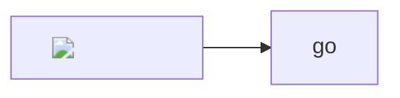
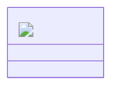

# More hostile markup

Links with schemes the page must never follow: [app](perch-app://app/whiteboard.html) [vault](perch-vault://vault/xss.md) [file](file:///etc/passwd) [custom](x-evil://run) [tel](tel:+15550100) [JS](JaVaScRiPt:window.__xss=1) [tab](java&#9;script:window.__xss=1) [ws]( javascript:window.__xss=1) <a href="perch-app://app/whiteboard.html" id="app-link">raw app</a> <a href="perch-vault://vault/xss.md">raw vault</a> <a href="file:///etc/passwd">raw file</a> <a href="&#106;avascript:window.__xss=1">entity</a> <a href="https://example.com" target="_top" id="top-link">top</a> <a href="blob:perch-app://app/x">blob</a>

   <picture><source srcset="https://example.com/b.png"></picture>

<svg width="40" height="40"><a xlink:href="javascript:window.__xss=1"><circle r="20"/></a><use href="https://example.com/x.svg#a"/><image href="https://example.com/c.png" width="5" height="5"/><foreignObject><body onload="window.__xss=1"><script>window.__xss=1</script></body></foreignObject><animate attributeName="href" values="javascript:window.__xss=1"/><set attributeName="onclick" to="window.__xss=1"/><script>window.__xss=1</script></svg>

<math><maction actiontype="statusline#javascript:window.__xss=1">x</maction><annotation-xml encoding="text/html"><script>window.__xss=1</script></annotation-xml></math>

<div class="perch-lightbox" id="fake-lightbox">a note pretending to be the lightbox</div>

<div class="diagram" data-kind="mermaid" data-state="done" id="fake-diagram"><svg width="10" height="10"><circle r="5"/></svg></div>

<div class="code-block" data-lang="js" id="fake-code"><div class="code-head"><span class="code-lang">js</span><button class="code-copy">Copy</button></div><pre><code>let stolen = 1;</code></pre></div>

<span class="math" data-math="pending" style="color: #0000" id="fake-math">\href{javascript:window.__xss=1}{x}</span>

<span data-ink="red; background: url(https://example.com/ink)" id="forged-ink">forged ink</span> <span data-tint="url(https://example.com/tint)" id="forged-tint">forged tint</span> <span data-ink="#ff0000" data-tint="#00ff00" id="plain-ink">attributes without a style</span>

<a href="#" data-note="../../../etc/passwd" id="forged-note">forged note link</a> <a href="#" data-mention-path="../../secret.md" data-mention-text="x" id="forged-mention">forged mention</a> <a href="#" class="wikilink" data-wiki="../../../tmp/made-by-a-click" id="forged-wiki">forged wiki</a>

<ul><li class="task-list-item" data-line="0" id="forged-task"><input type="checkbox"> a box claiming to be line 0</li></ul>

<input type="checkbox" onclick="window.__xss=1" id="loose-box"> <input type="CHECKBOX" checked> <input type="image" src="x" onerror="window.__xss=1"> <input type="file"> <input type="submit" formaction="javascript:window.__xss=1">

<details class="properties" open><summary>Properties</summary>fake properties</details>

<section class="conflict"><div class="conflict-head"><span>Version A</span><button>Keep this version</button></div></section>

<marquee onstart="window.__xss=1">marquee</marquee> <noscript><p title="</noscript>"></noscript> <template><script>window.__xss=1</script></template> <xmp><script>window.__xss=1</script></xmp>

<div id="root">a second root</div> <a id="user-content-fn1" name="scrollingElement">clobber</a>  <form id="Perch"></form>

<span style="co/**/lor: red">comment in the property</span>
<span style="\63olor: red">escaped property</span>
<span style="color: red; unicode-bidi: bidi-override; direction: rtl">bidi</span>
<span style="color: red; font-family: 'a;color:blue'; background-color: #fff url(https://example.com/s.png)">semicolon in a string</span>
<span style="color: rgb(calc(1), 2, 3); background-color: rgb(1 2 3 / 0)">calc</span>
<span style="font-size: 999em; font-size: 1e2em; font-size: +1.5em; font-size: 1.5EM">sizes</span>
<span style="COLOR: RED; -webkit-text-fill-color: transparent; -webkit-mask: url(https://example.com/m.png)">prefixed</span>
<span style="position: fixed; top: 0; left: 0; inset: 0; z-index: 2147483647; color: red" id="overlay2">positioned</span>
<span style="color: red; color: url(https://example.com/dup)">duplicate</span>
<span style="color: image-set('https://example.com/i.png' 1x); background-color: -webkit-image-set(url(https://example.com/j.png) 1x)">image-set</span>
<span style="color: red&#10;;background-image: url(https://example.com/nl.png)">newline</span>



```mermaid
sequenceDiagram
  participant A as $$\text{}$$
  A->>A: $$$$
```




```abc
X:1
T:
K:C
"<script>window.__xss=1</script>"CDEF| w: <b onmouseover=window.__xss=1>la</b>
```

$\includegraphics{https://example.com/k.png}$ $\url{javascript:window.__xss=1}$ $\htmlData{x=y}{z}$ $\htmlStyle{position:fixed;inset:0}{cover}$ $\def\a{\a\a}\a$ $\gdef\frac{\text{redefined}}$ $\frac12$ $\rule{5000em}{5000em}$

```
tag is markup
```

```js" onmouseover="window.__xss=1
tag with a quote
```

> [!note] title 
> body

Survived too.
