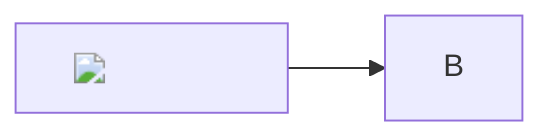

# Hostile note

<script>window.__xss = (window.__xss || 0) + 1</script>


<svg onload="window.__xss = (window.__xss || 0) + 1"><circle r="5"/></svg>

<a href="javascript:window.__xss = 1">js link</a> [md js link](javascript:window.__xss=1) [data link](data:text/html,<script>window.__xss=1</script>)

<iframe src="javascript:parent.__xss = 1"></iframe>
<iframe srcdoc="<script>parent.__xss = 1</script>"></iframe>

<object data="javascript:window.__xss=1"></object><embed src="javascript:window.__xss=1">

<form action="https://example.com"><input name="q" value="typed"><button>Send</button></form>

<input type="text" value="a text field">

<style>#root { display: none !important; } body { background: red; }</style>

<link rel="stylesheet" href="https://example.com/x.css">

<meta http-equiv="refresh" content="0;url=https://example.com">

<base href="https://example.com/">

<div onclick="window.__xss = 1" onmouseover="window.__xss = 1" id="hostile-div">click me</div>

<math><mtext><table><mglyph><style><!--</style>

<details ontoggle="window.__xss = 1" open><summary>x</summary>y</details>

<video src="x" onerror="window.__xss = 1"></video><audio src="x" onerror="window.__xss = 1"></audio>

<button onclick="window.__xss = 1" class="code-copy">fake copy</button>

<a class="wikilink" data-wiki="Injected" href="#">fake wiki</a>

<div data-conflict="0">fake conflict</div>

<span style="background:url(javascript:window.__xss=1)">css url</span>
<span style="position:fixed;inset:0;z-index:99999;background:red" id="overlay">overlay</span>
<span style="color: red; behavior: url(x.htc); -moz-binding: url(x)">legacy</span>
<span style="font-size: 900em">huge</span>
<span style="color: expression(window.__xss=1)">expression</span>
<span style="color: var(--x, url(https://example.com/leak))">var trick</span>
<span style="color: red !important; display: none">important</span>
<div style="@import url(https://example.com/x.css); width: 5000px">at rule</div>
<span style="color:#f00;background-image:url('https://example.com/track.png')">tracker</span>

```html
<script>window.__xss = 1</script>
```



$\href{javascript:window.__xss=1}{math link}$ and $\htmlClass{x}{y}$

 

[[Target" onmouseover="window.__xss=1]] [[]]

Survived.
